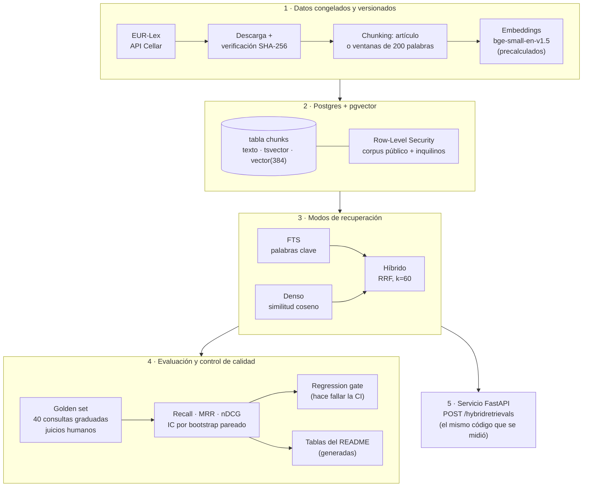

# Evaluación de recuperación híbrida sobre legislación financiera de la UE

[English](README.md) · **Español**

[](https://github.com/jcayama/HybridRetrieval-EU-FinancialLegislation/actions/workflows/ci.yml)  

> **¿La búsqueda híbrida supera de verdad a la de palabras clave?** Este proyecto lo mide sobre tres normas financieras de la UE, con un conjunto de prueba congelado y etiquetado por una persona, intervalos de confianza y un relato claro de lo que los datos pueden y no pueden demostrar.

## Resumen

**Qué es.** Un experimento reproducible que mide qué tan bien tres formas de buscar encuentran el artículo correcto en
tres normas financieras de la UE: AIFMD (Directiva de gestores de fondos de inversión alternativos), DORA (Reglamento de
resiliencia operativa digital) y el Reglamento de IA. Las tres formas son la búsqueda por palabras clave (búsqueda de
texto completo de Postgres), la búsqueda semántica (embeddings almacenados con pgvector) y un híbrido de ambas
(Reciprocal Rank Fusion). Está construido sobre Postgres + pgvector y viene con un conjunto de prueba congelado y
etiquetado por una persona, un regression gate en la CI (integración continua), aislamiento por inquilino a nivel de fila
y una API pequeña que puedes consultar tú mismo.

**Resultados principales** (generados desde `results/`; las tablas completas están en [Resultados](#resultados)):

<!-- tldr:start -->
- **Cifra global más alta de nDCG@10 entre los sistemas principales:** Híbrido FTS + denso, con 0,667 con ventanas (0,641 con artículos), sobre 40 consultas.
- **Las únicas comparaciones que sobreviven a la corrección por comparaciones múltiples:** Híbrido FTS + denso (artículo) − FTS Postgres (artículo) (+0,158 nDCG@10); Híbrido FTS + denso (ventanas) − FTS Postgres (ventanas) (+0,148 nDCG@10). Cualquier otra diferencia entre los sistemas principales no es detectable con 40 consultas.
- **Ningún sistema gana en todos los tipos de consulta** (ventanas, nDCG@10): paráfrasis → Denso (bge-small) (0,666); término exacto → BM25 (0,830); multi-artículo → Híbrido FTS + denso (0,710).

nDCG@10 y Recall@10 con ventanas:

| Sistema | nDCG@10 | Recall@10 |
|---|---|---|
| BM25 | 0,584 | 0,744 |
| FTS Postgres | 0,519 | 0,762 |
| Denso (bge-small) | 0,644 | 0,771 |
| Híbrido FTS + denso | 0,667 | 0,867 |
| Híbrido BM25 + denso (exploratorio) | 0,672 | 0,831 |
<!-- tldr:end -->

**Cómo encaja todo**



**Pruébalo** (detalles en [Probar la API](#probar-la-api)):

```bash
docker compose up -d && python cli.py init-db && python cli.py load-db   # una vez; ver «Desarrollo»
uvicorn main:app --port 5013                                             # y abre http://localhost:5013/docs
```

**Ejemplo.** Una pregunta sobre plazos de notificación (respuesta abreviada: fragmentos recortados y coseno redondeado):

```bash
curl -s -X POST localhost:5013/hybridretrievals -H 'content-type: application/json' \
  -d '{"query": "How long do financial entities have to report a major ICT incident to the authority?", "top_k": 3}'
```

<!-- example:start -->
```json
{
  "query": "How long do financial entities have to report a major ICT incident to the authority?",
  "mode": "hybrid",
  "chunking": "window",
  "top_k": 3,
  "results": [
    {
      "rank": 1,
      "chunk_id": "32022R2554:art_19:w200:0",
      "act": "DORA 2022/2554",
      "celex": "32022R2554",
      "article": 19,
      "title": "Reporting of major ICT-related incidents and voluntary notification of significant cyber threats",
      "snippet": "1. Financial entities shall report major ICT-related incidents to the relevant competent…",
      "chunk_words": 200
    },
    {
      "rank": 2,
      "chunk_id": "32022R2554:art_17:w200:0",
      "act": "DORA 2022/2554",
      "celex": "32022R2554",
      "article": 17,
      "title": "ICT-related incident management process",
      "snippet": "1. Financial entities shall define, establish and implement an ICT-related incident…",
      "chunk_words": 200
    },
    {
      "rank": 3,
      "chunk_id": "32022R2554:art_18:w200:0",
      "act": "DORA 2022/2554",
      "celex": "32022R2554",
      "article": 18,
      "title": "Classification of ICT-related incidents and cyber threats",
      "snippet": "1. Financial entities shall classify ICT-related incidents and shall determine their…",
      "chunk_words": 200
    }
  ],
  "abstained": false,
  "best_cosine": 0.818
}
```
<!-- example:end -->

El artículo 19 de DORA es el artículo correcto. Ojo: remite a los plazos pero no los fija: su apartado 4 habla de plazos que se establecerán en normas técnicas (artículo 20), que no forman parte del corpus. El sistema recupera artículos; no responde preguntas.

Una consulta ajena al corpus no se fuerza a dar resultados (en [Probar la API](#probar-la-api) se explica cuándo se aplica):

<!-- example-abstention:start -->
```json
{
  "query": "What is the best pizza recipe in Naples?",
  "mode": "hybrid",
  "chunking": "window",
  "top_k": 3,
  "results": [],
  "abstained": true,
  "best_cosine": 0.348
}
```
<!-- example-abstention:end -->

**Qué demuestra este proyecto**

- **Ingeniería de recuperación:** búsqueda léxica, densa e híbrida con Reciprocal Rank Fusion, escrita a mano sobre
  Postgres + pgvector (sin framework en el recuperador).
- **Evaluación como ingeniería:** un golden set congelado, Recall / MRR / nDCG, intervalos de confianza por bootstrap
  pareado, comparaciones declaradas antes de calcularlas, corrección por comparaciones múltiples y resultados
  exploratorios etiquetados como tales.
- **Reproducibilidad:** corpus con hash, revisión del modelo fijada, embeddings versionados y tablas del README
  generadas por un script y comprobadas en la CI.
- **Controles de calidad:** un regression gate y tests de aislamiento entre inquilinos que hacen fallar la CI, con tests
  verificados rompiendo el código a propósito (mutaciones).
- **Seguridad de los datos:** Row-Level Security con un rol sin privilegios y políticas que fallan cerradas, más una
  lista honesta de lo que no cubre.

**Límites que conviene conocer antes de seguir**

- 40 consultas y un solo anotador, sin pooling: la mayoría de las diferencias entre sistemas **no son detectables
  estadísticamente** (ver [Resultados](#resultados)).
- Solo se indexan los artículos (sin considerandos ni anexos) y las consultas deben estar en inglés.
- La API no tiene autenticación ni pool de conexiones: es una demostración, no un servicio de producción.

> **Estado:** los siete criterios de «hecho» están implementados y medidos, y la CI de GitHub Actions se ha ejecutado
> con éxito sobre el historial publicado. Si en el futuro el regression gate fallara por diferencias de plataforma,
> habría que recalibrar sus umbrales con los números que muestre (ver [Regression gate](#regression-gate)).

## Qué se evalúa

Siete criterios, todos implementados y medidos:

1. Chunking por artículo frente a ventanas fijas.
2. Búsqueda de texto completo (FTS de Postgres) frente a búsqueda densa (pgvector) frente a híbrido con Reciprocal Rank
   Fusion (RRF).
3. Recall@K, MRR (Mean Reciprocal Rank) y nDCG@10 (normalized Discounted Cumulative Gain) sobre un golden set congelado
   de 40 consultas: 15 paráfrasis, 15 de término exacto y 10 multi-artículo con relevancia graduada.
4. Índices HNSW frente a IVFFlat (recall y latencia).
5. Aislamiento multi-inquilino con Row-Level Security (RLS) y un test que falla ante cualquier fuga.
6. Un workflow de GitHub Actions que falla si Recall@K cae por debajo de un umbral o si el test de RLS detecta una fuga.
7. Tests unitarios del evaluador con un ejemplo hecho a mano (contrastado además con scikit-learn).

## Corpus

Texto publicado (no consolidado) de tres actos de la UE, descargado de la API Cellar de EUR-Lex:

| Acto | CELEX |
|------|-------|
| Directiva AIFMD 2011/61/UE | 32011L0061 |
| Reglamento DORA (UE) 2022/2554 | 32022R2554 |
| Reglamento de IA (UE) 2024/1689 | 32024R1689 |

El corpus se congela guardando el SHA-256 de cada descarga y versionando los chunks en JSONL.

- `data/raw/`: HTML descargado de EUR-Lex. **No se versiona**: se vuelve a descargar y se valida con el hash.
- `data/corpus.sha256`: hashes congelados del corpus. **Sí** se versiona; es lo que garantiza que todos trabajan con el
  mismo texto.
- `data/abstention/`: 20 consultas sin respuesta (10 fuera de tema, 10 casi del dominio) para estudiar la abstención. Que no tengan respuesta en el corpus lo afirma el autor, están congeladas con hash y **no** forman parte del golden set.
- `data/chunks/`: chunks en JSONL (`articles.jsonl` y `windows_w200_o40.jsonl`). **Sí** se versionan. Un test comprueba
  que regenerarlos desde el corpus congelado da exactamente los mismos ficheros (ese test necesita el HTML descargado,
  así que se ejecuta en local y se salta en la CI).

**Datos y privacidad.** Solo se usan datos públicos o sintéticos. No hay datos de clientes en este repositorio.

## Resultados

Qué leer de esta sección y qué no:

- **Una sola persona juzgó la relevancia** de **40 consultas** sobre un corpus de 248 artículos, sin pooling, así que
  las diferencias pequeñas entre sistemas **no son estadísticamente sólidas**. Los intervalos son de bootstrap pareado
  sobre consultas y no recogen la variabilidad entre construcciones de un índice aproximado.
- Las **comparaciones principales** se declararon antes de calcularlas; las **exploratorias** (ideas posteriores a ver
  resultados) se informan aparte y con una corrección más estricta. Con tantas comparaciones, que alguna excluya el
  cero al 95 % es esperable por azar: por eso se muestra también la corrección de Bonferroni.
- Las métricas usan relevante = grado ≥ 2 para Recall y MRR, y ganancia lineal en nDCG (ver
  [Método de evaluación](#golden-set-y-método-de-evaluación)).
- Todo el bloque siguiente lo escribe `python cli.py report`; `python cli.py report --check` falla si está
  desactualizado.

<details>
<summary>Tablas completas de resultados (clic para desplegar)</summary>

<!-- results:start -->
#### Métricas globales (40 consultas)

| Sistema | Chunking | Recall@1 | Recall@3 | Recall@5 | Recall@10 | nDCG@10 [IC 95 %] | MRR@10 |
|---|---|---|---|---|---|---|---|
| BM25 | artículo | 0,252 | 0,431 | 0,598 | 0,727 | 0,545 [0,443, 0,647] | 0,544 |
| BM25 | ventanas | 0,310 | 0,552 | 0,585 | 0,744 | 0,584 [0,475, 0,689] | 0,608 |
| FTS Postgres | artículo | 0,237 | 0,371 | 0,496 | 0,675 | 0,483 [0,377, 0,593] | 0,464 |
| FTS Postgres | ventanas | 0,242 | 0,369 | 0,523 | 0,762 | 0,519 [0,420, 0,619] | 0,507 |
| Denso (bge-small) | artículo | 0,327 | 0,500 | 0,604 | 0,690 | 0,555 [0,451, 0,658] | 0,623 |
| Denso (bge-small) | ventanas | 0,377 | 0,598 | 0,640 | 0,771 | 0,644 [0,546, 0,740] | 0,688 |
| Híbrido FTS + denso | artículo | 0,340 | 0,515 | 0,683 | 0,827 | 0,641 [0,555, 0,725] | 0,675 |
| Híbrido FTS + denso | ventanas | 0,369 | 0,577 | 0,673 | 0,867 | 0,667 [0,575, 0,759] | 0,693 |
| Híbrido BM25 + denso (exploratorio) | artículo | 0,356 | 0,510 | 0,644 | 0,767 | 0,615 [0,519, 0,709] | 0,696 |
| Híbrido BM25 + denso (exploratorio) | ventanas | 0,365 | 0,613 | 0,690 | 0,831 | 0,672 [0,586, 0,759] | 0,726 |

#### nDCG@10 por tipo de consulta

| Sistema | Chunking | Paráfrasis (15) | Término exacto (15) | Multi-artículo (10) |
|---|---|---|---|---|
| BM25 | artículo | 0,384 | 0,727 | 0,515 |
| BM25 | ventanas | 0,378 | 0,830 | 0,521 |
| FTS Postgres | artículo | 0,425 | 0,617 | 0,369 |
| FTS Postgres | ventanas | 0,366 | 0,613 | 0,606 |
| Denso (bge-small) | artículo | 0,688 | 0,360 | 0,649 |
| Denso (bge-small) | ventanas | 0,666 | 0,619 | 0,649 |
| Híbrido FTS + denso | artículo | 0,702 | 0,575 | 0,651 |
| Híbrido FTS + denso | ventanas | 0,640 | 0,665 | 0,710 |
| Híbrido BM25 + denso (exploratorio) | artículo | 0,613 | 0,592 | 0,652 |
| Híbrido BM25 + denso (exploratorio) | ventanas | 0,566 | 0,770 | 0,685 |

#### Comparaciones principales (nDCG@10 global, bootstrap pareado sobre consultas)

- Con chunking por artículo, la cifra global más alta de nDCG@10 entre los sistemas principales es la de **Híbrido FTS + denso** (0,641).
- Con chunking por ventanas, la cifra global más alta de nDCG@10 entre los sistemas principales es la de **Híbrido FTS + denso** (0,667).
- Que una cifra sea la más alta **no implica** que la diferencia sea detectable: cuentan las comparaciones de abajo, no el orden de las tablas.
- De las 15 comparaciones principales, **5** excluyen el cero con un IC del 95 % y **2** lo siguen excluyendo tras la corrección de Bonferroni para 15.
- Las que sobreviven a la corrección son: **Híbrido FTS + denso (artículo) − FTS Postgres (artículo)**; **Híbrido FTS + denso (ventanas) − FTS Postgres (ventanas)**.
- Excluyen el cero solo al 95 %, sin corrección (indicios, no hallazgos): Denso (bge-small) (ventanas) − FTS Postgres (ventanas); Denso (bge-small) (ventanas) − Denso (bge-small) (artículo); Híbrido FTS + denso (artículo) − Denso (bge-small) (artículo).

| Comparación (A − B) | Dif. nDCG@10 | IC 95 % | IC Bonferroni (15) | Excluye 0 (95 %) | Excluye 0 (Bonferroni) |
|---|---|---|---|---|---|
| BM25 (artículo) − FTS Postgres (artículo) | +0,062 | [−0,039, +0,162] | [−0,096, +0,214] | no | no |
| BM25 (ventanas) − FTS Postgres (ventanas) | +0,065 | [−0,026, +0,163] | [−0,065, +0,212] | no | no |
| FTS Postgres (ventanas) − FTS Postgres (artículo) | +0,036 | [−0,045, +0,117] | [−0,087, +0,158] | no | no |
| BM25 (ventanas) − BM25 (artículo) | +0,039 | [−0,005, +0,080] | [−0,029, +0,101] | no | no |
| Denso (bge-small) (artículo) − BM25 (artículo) | +0,010 | [−0,138, +0,152] | [−0,210, +0,218] | no | no |
| Denso (bge-small) (ventanas) − BM25 (ventanas) | +0,061 | [−0,074, +0,191] | [−0,142, +0,254] | no | no |
| Denso (bge-small) (artículo) − FTS Postgres (artículo) | +0,072 | [−0,081, +0,219] | [−0,161, +0,287] | no | no |
| Denso (bge-small) (ventanas) − FTS Postgres (ventanas) | +0,125 | [+0,011, +0,233] | [−0,052, +0,285] | sí | no |
| Denso (bge-small) (ventanas) − Denso (bge-small) (artículo) | +0,089 | [+0,014, +0,177] | [−0,014, +0,229] | sí | no |
| Híbrido FTS + denso (artículo) − Denso (bge-small) (artículo) | +0,086 | [+0,015, +0,162] | [−0,021, +0,198] | sí | no |
| Híbrido FTS + denso (ventanas) − Denso (bge-small) (ventanas) | +0,023 | [−0,048, +0,095] | [−0,081, +0,137] | no | no |
| Híbrido FTS + denso (artículo) − FTS Postgres (artículo) | +0,158 | [+0,059, +0,255] | [+0,016, +0,300] | sí | **sí** |
| Híbrido FTS + denso (ventanas) − FTS Postgres (ventanas) | +0,148 | [+0,068, +0,232] | [+0,025, +0,278] | sí | **sí** |
| Híbrido FTS + denso (artículo) − BM25 (artículo) | +0,097 | [−0,016, +0,209] | [−0,072, +0,266] | no | no |
| Híbrido FTS + denso (ventanas) − BM25 (ventanas) | +0,083 | [−0,033, +0,202] | [−0,093, +0,256] | no | no |

#### Comparaciones exploratorias (ideas posteriores a ver los resultados)

Corrección de Bonferroni sobre 21 (las 15 principales más estas 6). 1 de 6 excluyen el cero al 95 % y 0 tras la corrección.

| Comparación (A − B) | Dif. nDCG@10 | IC 95 % | IC Bonferroni (21) | Excluye 0 (95 %) | Excluye 0 (Bonferroni) |
|---|---|---|---|---|---|
| Híbrido BM25 + denso (exploratorio) (artículo) − BM25 (artículo) | +0,070 | [−0,016, +0,154] | [−0,060, +0,198] | no | no |
| Híbrido BM25 + denso (exploratorio) (artículo) − Denso (bge-small) (artículo) | +0,060 | [−0,022, +0,145] | [−0,068, +0,193] | no | no |
| Híbrido BM25 + denso (exploratorio) (artículo) − Híbrido FTS + denso (artículo) | −0,026 | [−0,101, +0,037] | [−0,142, +0,064] | no | no |
| Híbrido BM25 + denso (exploratorio) (ventanas) − BM25 (ventanas) | +0,089 | [+0,008, +0,166] | [−0,035, +0,213] | sí | no |
| Híbrido BM25 + denso (exploratorio) (ventanas) − Denso (bge-small) (ventanas) | +0,028 | [−0,046, +0,104] | [−0,087, +0,145] | no | no |
| Híbrido BM25 + denso (exploratorio) (ventanas) − Híbrido FTS + denso (ventanas) | +0,005 | [−0,072, +0,084] | [−0,115, +0,121] | no | no |

#### Regression gate (margen 0,010, decisión manual)

| Chunking | Métrica | Valor en la calibración | Umbral |
|---|---|---|---|
| artículo | recall@10 | 0,827 | 0,815 |
| artículo | ndcg@10 | 0,641 | 0,630 |
| ventanas | recall@10 | 0,867 | 0,855 |
| ventanas | ndcg@10 | 0,667 | 0,655 |

#### Índices aproximados (recall@10 frente a la búsqueda exacta y latencia mediana)

| Conjunto | Método | Parámetros | Recall@10 | Latencia (ms) | Construcción (s) | Índice (MB) |
|---|---|---|---|---|---|---|
| Corpus real, ventanas (719 filas) | Exacta (referencia) | — | 1,000 | 0,78 | — | — |
|  | HNSW (ef_search=40) | ef_construction=64, m=16 | 0,995 | 0,84 | 0,1 | 1,5 |
|  | IVFFlat (probes=1) | lists=27 | 0,562 | 0,77 | 0,0 | 1,3 |
|  | IVFFlat (probes=10) | lists=27 | 0,963 | 0,74 | 0,0 | 1,3 |
| Corpus real, artículo (248 filas) | Exacta (referencia) | — | 1,000 | 0,74 | — | — |
|  | HNSW (ef_search=40) | ef_construction=64, m=16 | 1,000 | 0,90 | 0,0 | 0,5 |
|  | IVFFlat (probes=1) | lists=16 | 0,575 | 0,62 | 0,0 | 0,5 |
|  | IVFFlat (probes=10) | lists=16 | 0,983 | 0,65 | 0,0 | 0,5 |
| Sintético (100.000 filas) | Exacta (referencia) | — | 1,000 | 32,81 | — | — |
|  | HNSW (ef_search=40) | ef_construction=64, m=16 | 0,993 | 1,35 | 31,6 | 204,8 |
|  | IVFFlat (probes=1) | lists=100 | 0,998 | 1,46 | 2,6 | 164,3 |
|  | IVFFlat (probes=10) | lists=100 | 1,000 | 6,83 | 2,6 | 164,3 |

#### Análisis de errores (consultas malas del híbrido)

Una consulta es **mala** para un chunking si el nDCG@10 del híbrido es menor que 0,3 o no hay ningún artículo relevante (grado ≥ 2) en el top-10: 8 casos, de 5 consultas distintas. Cada caso se contrasta con una **sonda**: la misma consulta con **un solo cambio**. Detalle por caso (posiciones, términos, frecuencias) en `results/error_analysis.json`, generado con `python cli.py error-analysis`.

| Consulta | Tipo | Chunking | nDCG@10 híbrido (original → sonda) | Posición del artículo más relevante en el híbrido | Cambio de la sonda y lo que pone a prueba | Efecto |
|---|---|---|---|---|---|---|
| q006: How are the technology suppliers that financial firms depend on most identified and supervised? | Multi-artículo | artículo | 0,211 → 0,697 | DORA 31: 4 → 1 | «technology suppliers» → «ICT third-party service providers» (el texto usa otras palabras que la consulta) | explica el fallo |
| q018: stress tests | Término exacto | artículo | 0,076 → 0,821 | AIFMD 15: 25 → 2 | FTS con AND (`stress & test`) en lugar de OR (`ts_rank_cd` no pondera por rareza del término) | explica el fallo |
| q029: Can companies try out new AI systems under official supervision before placing them on the market? | Paráfrasis | artículo | 0,120 → 1,000 | AI Act 57: 13 → 1 | añadir «regulatory sandbox» (la paráfrasis evita el término que usa la norma) | explica el fallo |
| q036: register of information | Término exacto | artículo | 0,000 → 1,000 | DORA 28: 72 → 1 | FTS con proximidad (`regist <2> inform`) (FTS no trata la expresión como una unidad) | explica el fallo |
| q006: How are the technology suppliers that financial firms depend on most identified and supervised? | Multi-artículo | ventanas | 0,245 → 0,687 | DORA 31: 3 → 1 | «technology suppliers» → «ICT third-party service providers» (el texto usa otras palabras que la consulta) | explica el fallo |
| q018: stress tests | Término exacto | ventanas | 0,070 → 0,821 | AIFMD 15: 17 → 2 | FTS con AND (`stress & test`) en lugar de OR (`ts_rank_cd` no pondera por rareza del término) | explica el fallo |
| q028: How large can the fines be for companies that break the AI rules? | Paráfrasis | ventanas | 0,289 → 1,000 | AI Act 99: 10 → 1 | quitar «AI» de la consulta (un término genérico presente en muchos chunks domina el FTS) | explica el fallo |
| q029: Can companies try out new AI systems under official supervision before placing them on the market? | Paráfrasis | ventanas | 0,000 → 0,945 | AI Act 57: 18 → 1 | añadir «regulatory sandbox» (la paráfrasis evita el término que usa la norma) | explica el fallo |

- Efecto de la sonda (regla fijada antes de calcular): **explica el fallo** si el nDCG@10 del híbrido sube al menos 0,1; **parcial** si sube menos; **sin efecto** si no sube. Que una sonda explique el nDCG@10 de la consulta no significa que se recuperen todos sus artículos juzgados: las posiciones por artículo están en el JSON.
- Las sondas se redactaron **sabiendo cuál es el artículo relevante**: muestran que una causa es *suficiente* para explicar el fallo, no que ese cambio mejore el sistema en general. No se usan para modificar el sistema ni el golden set.
- Un artículo recuperado que el golden set no juzgó cuenta como fallo (ver «Sin pooling»): parte de estos casos puede ser un juicio incompleto y no un error del sistema. Decidirlo corresponde a quien pone los juicios.
- Son pocas consultas y un solo anotador: describen estos casos, no permiten generalizar.

#### Abstención: coseno del mejor chunk (golden set frente a consultas sin respuesta)

¿Podría un umbral sobre el coseno del mejor chunk hacer que el recuperador se abstenga ante consultas sin respuesta? Se compara el coseno de las 40 consultas del golden set (con respuesta) con el de 20 consultas sin respuesta (10 fuera de tema y 10 «casi del dominio», fuera del corpus), puestas por quien pone los juicios, en `data/abstention/` (congeladas con hash). Se calcula con `python cli.py abstention`; la API aplica el umbral propuesto con ventanas (`data/abstention/threshold.json`, redondeado hacia abajo a milésimas) en `dense` e `hybrid`, solo para descartar consultas claramente ajenas; con artículos no se abstiene, porque ahí el umbral rechaza consultas legítimas.

| Chunking | Grupo | Consultas | Coseno mínimo | Mediana | Máximo |
|---|---|---|---|---|---|
| artículo | Golden set (con respuesta) | 40 | 0,518 | 0,707 | 0,859 |
| artículo | Sin respuesta, fuera de tema | 10 | 0,348 | 0,441 | 0,557 |
| artículo | Sin respuesta, casi del dominio | 10 | 0,621 | 0,664 | 0,701 |
| ventanas | Golden set (con respuesta) | 40 | 0,556 | 0,722 | 0,845 |
| ventanas | Sin respuesta, fuera de tema | 10 | 0,348 | 0,444 | 0,549 |
| ventanas | Sin respuesta, casi del dominio | 10 | 0,611 | 0,679 | 0,712 |

| Chunking | Golden set frente a… | AUC [IC 95 %] |
|---|---|---|
| artículo | todas las consultas sin respuesta | 0,868 [0,769, 0,944] |
| artículo | solo fuera de tema | 0,995 [0,978, 1,000] |
| artículo | solo casi del dominio | 0,740 [0,600, 0,865] |
| ventanas | todas las consultas sin respuesta | 0,876 [0,779, 0,949] |
| ventanas | solo fuera de tema | 1,000 [1,000, 1,000] |
| ventanas | solo casi del dominio | 0,752 [0,613, 0,873] |

| Chunking | Umbral | Golden set conservado | Fuera de tema rechazadas | Casi del dominio rechazadas |
|---|---|---|---|---|
| artículo | 0,50 | 40/40 | 8/10 | 0/10 |
| artículo | 0,54 | 39/40 | 9/10 | 0/10 |
| artículo | 0,58 | 38/40 | 10/10 | 0/10 |
| artículo | 0,62 | 33/40 | 10/10 | 0/10 |
| artículo | 0,66 | 31/40 | 10/10 | 4/10 |
| artículo | 0,70 | 22/40 | 10/10 | 9/10 |
| artículo | 0,74 | 11/40 | 10/10 | 10/10 |
| artículo | 0,78 | 5/40 | 10/10 | 10/10 |
| ventanas | 0,50 | 40/40 | 7/10 | 0/10 |
| ventanas | 0,54 | 40/40 | 9/10 | 0/10 |
| ventanas | 0,58 | 39/40 | 10/10 | 0/10 |
| ventanas | 0,62 | 36/40 | 10/10 | 1/10 |
| ventanas | 0,66 | 33/40 | 10/10 | 3/10 |
| ventanas | 0,70 | 26/40 | 10/10 | 8/10 |
| ventanas | 0,74 | 14/40 | 10/10 | 10/10 |
| ventanas | 0,78 | 7/40 | 10/10 | 10/10 |

Con chunking por artículo, el umbral que conserva al menos el 95 % del golden set (regla fijada antes de calcular) es **0,589**: conserva 38 de 40 consultas, rechaza 10 de 10 fuera de tema y 0 de 10 casi del dominio. Consultas del golden set que rechazaría: q021 «letter-box» (0,540); q031 «deep fake» (0,518).

Con chunking por ventanas, el umbral que conserva al menos el 95 % del golden set (regla fijada antes de calcular) es **0,610**: conserva 38 de 40 consultas, rechaza 10 de 10 fuera de tema y 0 de 10 casi del dominio. Consultas del golden set que rechazaría: q021 «letter-box» (0,556); q030 «floating point operations» (0,609).

- El AUC es la probabilidad de que una consulta con respuesta tenga más coseno que una sin respuesta (0,5 = no se distinguen; 1 = se separan del todo). Si los grupos no se solapan en la muestra, el bootstrap da un IC degenerado en 1,000: no mide incertidumbre real, solo que en estas consultas no hay solapamiento.
- Las consultas del golden set se escribieron «desde el artículo», así que su coseno es más alto que el de un usuario real; y el umbral se calibra con las mismas consultas con las que se evalúa. Ambas cosas lo hacen optimista.
- Que las consultas sin respuesta no tengan respuesta en el corpus lo afirma quien pone los juicios, no un script. Con 40 y 20 consultas, los intervalos son anchos: es un indicio, no un umbral definitivo.
<!-- results:end -->

</details>

## Probar la API

```bash
docker compose up -d && python cli.py init-db && python cli.py load-db   # una vez (ver «Desarrollo»)
uvicorn main:app --port 5013
```

Abre <http://localhost:5013/docs> (interfaz interactiva) o usa `curl`:

```bash
curl -s -X POST localhost:5013/hybridretrievals -H 'content-type: application/json' \
  -d '{"query": "What must a bank write into its contract with a cloud provider?", "top_k": 5}'
```

| Campo | Valores | Por defecto |
|---|---|---|
| `query` | de 1 a 500 caracteres, **en inglés**; las siglas cortas (`TLPT`) son válidas | — |
| `top_k` | 1 a 50 artículos distintos | 10 |
| `mode` | `hybrid` (FTS + denso con RRF k=60), `fts`, `dense` | `hybrid` |
| `chunking` | `window` (ventanas de 200 palabras), `article` | `window` |

Cada resultado trae `rank`, `chunk_id`, `act`, `celex`, `article`, `title`, un `snippet` de unos 400 caracteres y
`chunk_words` (el tamaño del chunk devuelto). `GET /health` indica si responden la base de datos y el modelo.

- **Abstención (solo para consultas claramente ajenas):** en `dense` e `hybrid`, si el coseno del mejor chunk queda bajo un
  umbral (`data/abstention/threshold.json`: 0,609, calibrado como se describe en [Resultados](#resultados)) **y
  `chunking=window`**, la respuesta es un `200` con `results: []`, `abstained: true` y el `best_cosine` que lo
  explica. `fts` nunca se abstiene y no necesita el modelo. Está activa por defecto; `API_ENABLE_ABSTENTION=false` la
  desactiva, y `/health` informa de `abstention`. **Solo descarta consultas claramente ajenas al corpus** (la pizza, el
  fútbol): no detecta las «casi del dominio» (MiFID, Basel) y puede rechazar por error consultas cortas de término exacto:
  rechaza 2 de las 40 consultas del golden set. Con `chunking=article` **no** se abstiene: allí el umbral rechazaba
  además consultas legítimas como `social scoring` (un término real del AI Act) y los grupos se solapan más.
- **Qué es el fragmento:** con `chunking=window` es el inicio de la ventana que mejor encajó. Con `chunking=article` el
  chunk es el artículo entero (el `chunk_id` termina en `art_N`), así que el fragmento es el **pasaje que más coincide
  con las palabras de la consulta** (`ts_headline` de Postgres), con «…» donde se recorta; si la consulta no comparte
  palabras con el artículo (por ejemplo en modo `dense`), es el inicio del artículo. Los fragmentos de artículo cuestan
  más tiempo que los de ventana porque `ts_headline` procesa artículos enteros (no medido).

- **Dos niveles de instalación:** con `requirements.txt` (sin torch) funciona `mode=fts`. `hybrid` y `dense` embeben
  la consulta con el modelo y necesitan `pip install -r requirements-embeddings.txt` (torch, cientos de MB); sin
  él devuelven un **503** que lo explica. El modelo se carga al arrancar el servidor, fuera del bucle de eventos.
- **Qué garantiza que el endpoint hace lo que se midió:** `tests/test_api_parity.py` comprueba que, para las 40
  consultas del golden set, el endpoint devuelve **exactamente** los rankings que `evaluate` midió, con FTS, denso e
  híbrido y con ambos chunkings. En la CI se ejecuta la parte de FTS; las que necesitan el modelo, solo en local.
- **Errores** (`{"errors": [{"code", "title"}]}`): `E0001` consulta vacía o de más de 500 caracteres (400),
  `E0002` modelo no disponible (503), `E0003` cabecera `X-Tenant-ID` no válida (400), `E0004` base de datos no
  disponible o sin cargar (503). Los cuerpos mal formados dan el 422 habitual de FastAPI. Los fallos inesperados dan
  un 500 con un `error_id` y sin detalles internos.
- **Inquilinos (demostración, no seguridad):** por defecto solo se ve el corpus público y la cabecera se ignora. Con
  `API_ENABLE_TENANTS=true`, `X-Tenant-ID` activa el aislamiento por RLS (ver
  [Aislamiento multi-inquilino](#aislamiento-multi-inquilino-rls)). **No hay autenticación: cualquiera puede declarar
  cualquier inquilino**, así que no debe usarse para proteger datos reales.
- **Límites conocidos:** la abstención es un único umbral de coseno, no un juicio de relevancia; cada petición abre sus propias conexiones (sin pool); el manejador es asíncrono pero llama
  al código síncrono del pipeline en un hilo (`asyncio.to_thread`) en lugar de usar `AsyncConnection`; sin
  autenticación ni límite de peticiones; CORS solo para `https://localhost:5013`; la latencia por petición no se ha
  medido.

## Cómo funciona

### Chunking

<details>
<summary>Mostrar detalles</summary>

- **Alcance:** solo artículos (248: AIFMD 71, DORA 64, AI Act 113). Considerandos y anexos quedan fuera.
- **Por artículo:** un chunk por artículo, con cabecera `Article N. Título`.
- **Por ventanas:** 200 palabras del cuerpo con solape de 40, sin cruzar el límite de un artículo; si la cola nueva
  tiene menos de 50 palabras se fusiona con la ventana anterior. Cada ventana empieza por la cabecera
  `Article N. Título` (sus palabras no cuentan para las 200).
- **Fidelidad:** el texto es literal; solo se normalizan espacios. Las filas de las listas `(a) ...` se unen en una
  línea.
- **Evaluación:** los juicios de relevancia se dan por artículo (`celex` + `article`), de modo que ambas estrategias se
  miden con los mismos juicios.

</details>

### Embeddings

<details>
<summary>Mostrar detalles</summary>

- **Modelo:** `BAAI/bge-small-en-v1.5` (MIT, 384 dimensiones, ventana de 512 tokens) fijado por hash de commit
  (`5c38ec7c…`). Elegido por criterios decididos antes de medir (ventana, licencia, tamaño, riesgo de
  configuración); no se comparó con otros sobre el golden set. `all-MiniLM-L6-v2` se descartó por su ventana de 256.
- **Consultas** con la instrucción de recuperación del modelo; **chunks** sin prefijo. Vectores normalizados (L2).
- **Precalculados y versionados** en `data/embeddings/` con un `manifest.json` (modelo, revisión, versiones de
  librerías y hashes de cada fichero y de su fuente). `load_embeddings` se niega a devolver vectores desfasados.
  La API y la CI no necesitan torch; solo `python cli.py embed` necesita `pip install -r requirements-embeddings.txt`.
- **Truncamiento medido** con el tokenizador real: **108 de 248 artículos (44 %) superan los 512 tokens** y se truncan
  (de media pierden el 36 % de sus tokens); **ninguna de las 719 ventanas** se trunca (máximo 416 tokens).
  Es una propiedad de «un chunk por artículo» con un modelo de contexto fijo.
- Los vectores pueden diferir en el último decimal entre plataformas; por eso `--verify` exige coseno >= 0,9999
  y no igualdad bit a bit.

</details>

### Sistemas de recuperación sobre Postgres

<details>
<summary>Mostrar detalles</summary>

- **FTS** (`scripts/fts.py`): configuración `'english'`; consulta = OR de los términos (por defecto Postgres
  exige todos); ranking `ts_rank_cd` con valores por defecto; desempate por `chunk_id`. Decisiones fijadas antes
  de medir.
- **Denso** (`scripts/dense.py`): columna `embedding vector(384)` en la misma tabla `chunks`; distancia coseno (`<=>`)
  con **búsqueda exacta, sin índice aproximado**; desempate por `chunk_id`. `load-db` carga también los vectores de
  `data/embeddings/` (se niega si están desfasados) y `evaluate --system dense` usa los vectores precalculados de las
  consultas del golden set, así que no necesita torch. La extensión `vector` se instala siempre en el esquema `public`.
- **Híbrido** (`scripts/rrf.py` y `scripts/hybrid.py`): RRF con k = 60 sobre los rankings de FTS y denso, cada uno con
  sus 200 mejores chunks. La fusión es **a nivel de chunk** (por `chunk_id`) y después se convierte a artículos
  distintos, igual que en los demás sistemas. RRF es una función pura con tests (ejemplo calculado a mano).
- **Híbrido BM25 + denso** (`--system hybrid-bm25`, **exploratorio**): misma fusión RRF con BM25 como entrada léxica.
  Es una idea posterior a ver los resultados del híbrido con FTS, así que sus comparaciones se declararon como
  exploratorias y se corrigen con Bonferroni sobre 21 (las 15 principales más estas 6). El resultado se informa
  tal cual, no cambia el sistema principal.
- `evaluate --system fts|dense|hybrid|hybrid-bm25` se niega a ejecutarse si los chunks (y, en denso, los embeddings)
  cargados en la base de datos no coinciden con `data/chunks/` (hay que repetir `load-db`).
- Los tests de base de datos usan un esquema temporal aislado y se saltan solos si no hay Postgres (en la CI fallan).

</details>

### Golden set y método de evaluación

<details>
<summary>Mostrar detalles</summary>

- `data/golden/queries.jsonl`: consultas (`query_id`, `type`, `theme`, `query`). Tipos: `paraphrase`,
  `exact_term` y `multi_article`. Las consultas están en inglés, como el corpus.
- `data/golden/qrels.jsonl`: juicios de relevancia, **una línea por par consulta-artículo**
  (`query_id`, `celex`, `article`, `grade`). Los escribe una persona; ningún LLM etiqueta.
- **Escala:** 3 = el artículo responde directamente; 2 = aporta una parte sustancial; 1 = relacionado,
  pero tangencial; lo no escrito = no relevante. El grado mide cuánto cubre ese artículo por sí solo,
  no el orden en que deba aparecer; puede haber varios artículos con el mismo grado.
- **Criterio de inclusión:** un artículo recibe juicio si **trata** el concepto de la consulta, no por
  mencionarlo de pasada. Por eso hay artículos que contienen el término de una consulta `exact_term`
  y no tienen juicio; `validate-golden` los lista como información para revisión.
- **Método:** consultas escritas «desde el artículo», juzgadas leyendo el texto, sin ayuda de ningún
  buscador, y congeladas antes de ejecutar ninguna recuperación.
- **Limitaciones:** conjunto pequeño (40 consultas) y un solo anotador; el método «desde el artículo»
  favorece ligeramente el acierto del artículo de origen. Las diferencias pequeñas entre sistemas no
  serán estadísticamente sólidas.
- **Sin pooling (decisión explícita):** los juicios son los independientes de la fase 1; no se ejecutó ninguna
  ronda de pooling. Un artículo relevante que el golden set no juzgó cuenta como fallo del sistema que lo
  recupera, así que **el recall absoluto puede estar subestimado**, y no necesariamente por igual en todos los
  sistemas: pueden salir perjudicados los que recuperan artículos relevantes distintos de los juzgados. Medido:
  el top-10 de los 10 sistemas evaluados (5 × 2 chunkings) deja **913 pares consulta-artículo sin juicio**, que
  cubren 217 de los 248 artículos del corpus; no se estimó qué fracción de ellos es relevante. Juzgarlos
  todos habría supuesto unas 723.000 palabras de lectura, y se descartó por coste. Las diferencias entre
  sistemas deben leerse con esta cautela.

**Método de evaluación.** Las métricas viven en `scripts/metrics.py` como funciones puras, con tests hechos a mano
(`tests/test_metrics.py`). Decisiones fijadas **antes** de ejecutar ninguna recuperación:

- **Unidad:** el artículo. Los rankings de chunks (ventanas) se convierten a artículos distintos,
  conservando la mejor posición de cada uno.
- **Relevante** (Recall y MRR): grado >= 2. El grado 1 solo cuenta en nDCG.
- **Métricas:** Recall@1, @3, @5 y @10, MRR@10 y nDCG@10 con ganancia lineal (3, 2, 1). La ganancia
  exponencial (7, 3, 1) queda como análisis de sensibilidad.
- **Incertidumbre:** bootstrap pareado sobre consultas (10.000 remuestras, semilla fija, intervalo
  percentil del 95 %), también por tipo de consulta. Con 15, 15 y 10 consultas por tipo, los intervalos
  serán anchos.

Ejemplo hecho a mano (juicios A=3, B=2, C=1; ranking X, B, A, Y, C con X e Y irrelevantes):
Recall@1 = 0, Recall@2 = 0,5, Recall@3 = 1, MRR = 0,5 y nDCG@5 = 0,6612
(DCG = 2/log2(3) + 3/log2(4) + 1/log2(6) = 3,1487; ideal A, B, C = 4,7619).

</details>

### Índices aproximados: HNSW frente a IVFFlat

<details>
<summary>Mostrar detalles</summary>

`python cli.py bench-index` mide recall frente a la **búsqueda exacta de Postgres** (la referencia) y latencia, con
parámetros fijados antes de medir: HNSW `m=16`, `ef_construction=64` y barrido de `ef_search`; IVFFlat con
`lists = filas/1000` (guía de pgvector) y barrido de `probes`. Las cifras completas están en
`results/index_benchmark.json`. Dos partes, con límites distintos:

- **Corpus real (719 ventanas y 248 artículos):** a esta escala **la búsqueda exacta es tan rápida como
  cualquier índice** (≈0,7–0,8 ms en todos los casos, donde domina el coste fijo de la consulta), así que los
  índices no aportan nada en latencia. Sí muestran recall: HNSW con `ef_search=40` ≥ 0,995 e IVFFlat con
  `probes=1` entre 0,56 y 0,58, con consultas que devuelven menos de 10 resultados.
- **Escala sintética (100.000 vectores):** datos **sintéticos** (perturbaciones de vectores reales con coseno
  0,93 respecto a su origen, calibrado con el coseno a los 10 vecinos más cercanos de las ventanas reales). La
  búsqueda exacta tarda ≈33 ms; HNSW con `ef_search=40` ≈1,4 ms con recall ≈0,99; IVFFlat con `probes=1`
  ≈1,5 ms con recall ≈0,998. **No se puede concluir de aquí que IVFFlat sea mejor:** estos datos son 719
  «nubes» muy marcadas, que favorecen a IVFFlat, y en el corpus real IVFFlat con `probes=1` rindió mucho peor.
  Lo que sí muestra la comparación es que el recall de HNSW fue ≥ 0,95 en los tres conjuntos con cualquier
  `ef_search`, mientras que el de IVFFlat depende mucho de los datos y de `probes`.
- **Varianza entre construcciones:** reconstruir el grafo HNSW (sin paralelismo) dio recall 0,993 y 0,975 con
  `ef_search=40`. Las diferencias entre valores de `ef_search` cercanos son menores que esa varianza y no deben
  interpretarse. Los intervalos del benchmark cubren la variabilidad entre consultas, no entre construcciones.
- **Efecto operativo:** HNSW devuelve como mucho `ef_search` filas. Con `ef_search=10`, el nDCG@10 del
  golden set con ventanas cae de 0,644 a 0,571, porque el ranking no llega a 10 artículos distintos; con 40
  coincide con la búsqueda exacta. IVFFlat con `probes=1` pierde ≈0,2 de nDCG.
- **Decisión para este proyecto:** con ~1.000 vectores se mantiene la búsqueda **exacta** (y el regression gate
  de la CI usa búsqueda exacta). Si el corpus creciera, la recomendación sería HNSW con `ef_search >= 40`.
- **Infraestructura:** en contenedores Docker (`/dev/shm` de 64 MB por defecto) una construcción paralela con
  `maintenance_work_mem` alto falla con «could not resize shared memory segment»; el benchmark construye sin
  paralelismo. La CI de GitHub tiene el mismo límite.
- **Latencia:** medida extremo a extremo desde Python (incluye serializar el vector de 384 números), con
  `shared_buffers` de 128 MB y el contenedor compartiendo CPU con otros procesos de la máquina.

</details>

### Aislamiento multi-inquilino (RLS)

<details>
<summary>Mostrar detalles</summary>

Modelo: el corpus legislativo es público y no pertenece a nadie; cada inquilino puede tener además **documentos
privados sintéticos** (`tenant_id`). `NULL` en `tenant_id` es el corpus público. Todos los datos de prueba son
sintéticos.

- **Políticas** en `chunks` (una por operación): `SELECT` ve el corpus público y lo propio; `INSERT` solo con el
  `tenant_id` propio; `UPDATE` y `DELETE` solo sobre filas propias (un inquilino **no puede modificar ni borrar el
  corpus público**, ni reasignar sus filas a otro inquilino). Si no hay inquilino fijado, **cero filas**, ni
  siquiera las públicas (falla cerrada).
- **Rol `app_user`** sin privilegios (no superusuario, sin `BYPASSRLS`, no propietario) y `FORCE ROW LEVEL SECURITY`.
- **Uso:** `db.tenant_transaction(conn, tenant_id)` al principio de cada petición ejecuta `SET LOCAL ROLE app_user`
  y `set_config('app.tenant_id', …, true)`. Ambos valen solo hasta el final de la transacción, así que no sobreviven en
  una conexión reutilizada de un pool; un ajuste de sesión (`is_local = false`) sí filtraría el inquilino anterior, y
  hay un test de control que lo demuestra. `SET LOCAL x = %s` no admite parámetros enlazados en psycopg 3; por eso
  `set_config`.
- **Búsquedas:** `FtsIndex`, `DenseIndex` y `HybridIndex` aceptan `tenant=`. Sin inquilino (la evaluación del golden
  set) solo ven el corpus público. `load-db` borra únicamente las filas públicas al recargar.
- **Tests** (`tests/test_rls.py`, contra Postgres real): cada inquilino ve lo público y lo propio y nunca lo ajeno;
  sin inquilino no ve nada; escrituras confinadas; el inquilino y el rol no sobreviven a la transacción; búsquedas
  FTS, densa e híbrida sin fugas. Se comprobó con mutaciones (sesión en lugar de transacción, política sin exigir
  inquilino, `UPDATE` sobre filas públicas, `INSERT` sin comprobación, RLS desactivado, etc.): todas se detectan.
- **HNSW + RLS:** el índice aproximado entrega sus candidatos antes del filtro de RLS. Con 200 filas de A pegadas a
  la consulta y 3.000 públicas lejos, el inquilino B con `ef_search=40` (el valor por defecto) recibe **0 filas**
  (nunca filas de A, pero tampoco las 10 pedidas). Con `ef_search=200` o con `hnsw.iterative_scan = relaxed_order`
  recibe las 10, todas públicas, igual que con búsqueda exacta. El caso está diseñado para mostrar el problema; la
  magnitud real depende de los datos. Es otra razón para mantener la búsqueda exacta con este corpus.

Limitaciones de esta implementación, a tener en cuenta:

- **Debilidad principal:** si la aplicación se conecta como el propietario y llama a `tenant_transaction`, **olvidar
  llamarla** deja esa petición con los privilegios del propietario, que ve todo. En producción la API debería
  conectarse directamente con un rol `LOGIN` que herede de `app_user`, de modo que olvidar fijar el inquilino dé cero
  filas. Esa configuración de conexión aún no está implementada ni integrada con FastAPI.
- `FORCE ROW LEVEL SECURITY` solo se verifica por catálogo: la conexión de prueba es superusuaria y los
  superusuarios siempre se saltan RLS, así que su efecto no se puede comprobar por comportamiento.
- `app.tenant_id` es un parámetro de configuración modificable desde la propia sesión: una inyección SQL podría
  cambiarlo. La defensa es usar siempre consultas parametrizadas; no se cubre aquí.
- Si el propietario no fuera superusuario, `FORCE` le aplicaría las políticas y la carga necesitaría `BYPASSRLS`.

</details>

### Regression gate

<details>
<summary>Mostrar detalles</summary>

`python cli.py gate` evalúa el sistema principal (**híbrido FTS + denso con RRF k=60, búsqueda exacta**) sobre el
golden set congelado y falla si **Recall@10 o nDCG@10**, con chunking por artículo o por ventanas, caen bajo los
umbrales de `data/gate/thresholds.json`. La CI lo ejecuta, junto con los tests de RLS.

- **Qué es y qué no es:** un gate **no compara sistemas con estadística** (el IC de muestreo del golden set es de
  ±0,1): detecta que la tubería haya cambiado de comportamiento sobre los mismos datos congelados. Por eso el margen
  depende del ruido de implementación y de plataforma, no del de muestreo.
- **Regla** (fijada antes de calcular, `scripts/gate.py`): ruido = el mayor entre la diferencia entre entornos
  observada para FTS (0,008) y el cambio máximo del híbrido al perturbar los vectores de consulta; margen =
  max(0,01, 3 × ruido) redondeado hacia arriba a múltiplos de 0,005; umbral = valor actual − margen, redondeado hacia
  abajo. Los umbrales se recalculan con `python cli.py calibrate-gate [--write-thresholds]`, y
  `python cli.py gate-margin X` fija un margen decidido a mano. Todo queda en `results/gate_calibration.json`.
- **Ruido medido:** perturbar los vectores de consulta con ruido relativo de 1e-6 y 1e-5 (100 veces el épsilon de
  `float32`) no movió ninguna métrica en 20 semillas; las métricas empiezan a moverse con ≈1e-3 (nDCG hasta 0,003) y
  con 1e-2 el Recall@10 llega a cambiar 0,025. La diferencia entre PostgreSQL de Homebrew y el contenedor, medida una
  sola vez para FTS, fue de hasta 0,008 (en Recall@3, que no es una métrica del gate) y ≤0,001 en Recall@10 y nDCG@10.
  **En GitHub Actions el gate pasó** con este margen. No se inspeccionó el registro de la ejecución, así que no se
  documenta qué arquitectura usó el runner ni qué valores midió allí: si algún día falla por plataforma, el propio
  registro los mostrará.
- **Sensibilidad** (en `results/gate_calibration.json`): el gate detecta consultas desalineadas con sus vectores,
  cambiar la configuración de FTS a `'simple'`, degradar el híbrido a solo denso o solo FTS, y cambiar RRF a k=1 con
  ventanas. **Con el margen de 0,025 no detecta** que las consultas pierdan la instrucción del modelo con ventanas
  (−0,014 de nDCG) ni RRF con k=1000 con artículos.
- **Límites:** protege el corpus y el golden set actuales; no detecta mejoras ni regresiones menores que el margen, y
  no sustituye a `evaluate` y `compare` para decidir entre sistemas.

</details>

### Integración continua (GitHub Actions)

<details>
<summary>Mostrar detalles</summary>

`.github/workflows/ci.yml` se ejecuta en cada `push` a `main` y en cada `pull request`, con dos trabajos independientes:

- **Escaneo de secretos:** gitleaks 8.30.1 (la misma versión que pre-commit) sobre **todo el historial**. El hook de
  pre-commit solo mira lo preparado en el índice (`--staged`), así que en la CI no habría escaneado nada; el paso
  comprueba además que se escaneó al menos un commit, para que no pueda dar un verde vacío.
- **Tests, RLS y regression gate:** servicio `pgvector/pgvector:pg17` (con `--shm-size`), instalación **sin torch**
  (se usan los embeddings precalculados y versionados), Ruff, `python cli.py report --check` (los README no pueden
  publicar cifras desfasadas), carga del corpus en Postgres, los tests de RLS por separado (fallan ante cualquier
  fuga), el resto de tests (incluida la paridad del endpoint con `evaluate` en FTS) y `python cli.py gate`.
  Cualquier fallo de estos pasos falla el trabajo. **En la CI, un servicio que debería estar disponible no salta
  los tests, los hace fallar** (`CI=true`); si no, una base de datos inaccesible dejaría la CI en verde sin haber
  comprobado nada.
- Las credenciales del servicio de Postgres del workflow son valores desechables de un contenedor efímero del
  runner, no secretos del proyecto.
- **Ensayo previo:** los pasos se reprodujeron en local sobre una copia limpia (sin `.env`, sin `data/raw/`, sin el
  entorno virtual), con `torch` inexistente y una base de datos nueva y vacía: Ruff, 15 tests de RLS, 1.678 tests
  (4 saltados por no haber corpus descargado ni modelo) y el gate con los mismos valores que en local.
- **Verificado en GitHub Actions:** el workflow se ejecutó en verde sobre el repositorio publicado (escaneo de
  secretos, Ruff, README al día, carga del corpus, tests con RLS y regression gate). Con ello quedan comprobadas las
  versiones de `actions/checkout@v4` y `actions/setup-python@v5` y el uso de `docker run --user` con gitleaks, que
  antes eran de memoria. **Límite:** solo se miró el resultado global, no el registro paso a paso; no se comprobó la
  arquitectura del runner ni los valores de las métricas medidos allí.
- **Fuera de la CI:** `download-corpus` (comprobar el hash contra EUR-Lex) no se ejecuta en cada commit, para no
  depender de la disponibilidad de EUR-Lex.

</details>

## Desarrollo

Requiere Python 3.12.

```bash
python3.12 -m venv .venv
source .venv/bin/activate
pip install -r requirements-dev.txt
pre-commit install   # imprescindible: activa el detector de secretos
cp .env.example .env # y rellena tus valores; .env nunca se versiona
```

El hook de pre-commit ejecuta [gitleaks](https://github.com/gitleaks/gitleaks), detecta claves privadas y bloquea
cualquier fichero `.env` (salvo `.env.example`). Los tests se ejecutan con `pytest` y el estilo se comprueba con
`ruff check .`.

### Postgres local

```bash
cp .env.example .env     # y define POSTGRES_USER, POSTGRES_PASSWORD y POSTGRES_DB (valores propios)
docker compose up -d     # imagen pgvector/pgvector:pg17, publicada solo en 127.0.0.1:5433
python cli.py init-db
python cli.py load-db
python cli.py evaluate --system fts
python cli.py evaluate --system dense
python cli.py evaluate --system hybrid
```

- El puerto es el **5433** (configurable con `POSTGRES_PORT`) para no chocar con un Postgres local en el 5432.
  Está publicado solo en la interfaz loopback: únicamente los programas de la propia máquina pueden conectarse.
- `docker-compose.yml` falla si faltan las credenciales; no hay secretos en el repositorio.

### Comandos

Todas las etapas del pipeline se lanzan desde un único punto de entrada, `cli.py`, desde la raíz del repositorio y con
el entorno virtual activo. `python cli.py --help` lista los comandos disponibles.

| Comando | Qué hace |
|---------|----------|
| `python cli.py download-corpus` | Descarga el corpus y **verifica** que el SHA-256 de cada acto coincide con `data/corpus.sha256` y que el número de artículos es el esperado (71, 64 y 113). Falla si algo no coincide. |
| `python cli.py download-corpus --freeze` | Igual, pero **escribe** `data/corpus.sha256`. Solo se usa la primera vez, para congelar el corpus. |
| `python cli.py chunk` | Genera los chunks a partir del corpus congelado (comprueba antes los hashes): uno por artículo y ventanas de 200 palabras con solape de 40. Escribe `data/chunks/*.jsonl`. |
| `python cli.py list-articles [--act dora\|aifmd\|aiact] [--range 17-23]` | Lista artículos (acto, número, título y nº de palabras). |
| `python cli.py show-article <acto> <N>` | Muestra el texto completo de un artículo, tal y como se indexa. |
| `python cli.py validate-golden` | Valida el golden set: formato, que los artículos existen, grados 1–3, consultas sin juicios; muestra avisos de revisión y el reparto por tipo. Falla si hay errores o si el golden set congelado se modificó. |
| `python cli.py freeze-golden` | Congela el golden set (SHA-256 en `data/golden/golden.sha256`). Solo con el conjunto completo. |
| `python cli.py compare <A> <B> [--metric ndcg@10] [--bonferroni N]` | Diferencia pareada A − B entre dos resultados de `results/` (p. ej. `bm25_window fts_window`), con intervalo bootstrap global y por tipo de consulta (y, con `--bonferroni N`, el global corregido para N comparaciones). Se niega si los resultados vienen de golden sets distintos. |
| `python cli.py embed [--verify] [--only NOMBRE]` | Calcula los embeddings de chunks y consultas con el modelo fijado y los guarda en `data/embeddings/`. Con `--verify` no recalcula: comprueba que una muestra se reproduce con lo guardado. Con `--only NOMBRE` (p. ej. `abstention_queries`) calcula solo esa fuente y deja intactos el resto del manifest y de los ficheros. Requiere `requirements-embeddings.txt`. |
| `python cli.py bench-index [--size N] [--skip-synthetic]` | Compara HNSW e IVFFlat (recall y latencia) en un esquema temporal que se borra al terminar; guarda `results/index_benchmark.json`. |
| `python cli.py gate` | Regression gate: falla si el híbrido (búsqueda exacta) cae bajo los umbrales de `data/gate/thresholds.json`. |
| `python cli.py calibrate-gate [--write-thresholds]` | Recalcula ruido, sensibilidad a regresiones y umbrales (local; requiere torch). |
| `python cli.py gate-margin X` | Fija a mano el margen del gate (≥ 0,01) y recalcula los umbrales desde la calibración guardada. |
| `python cli.py freeze-abstention` | Valida y congela (SHA-256) las consultas sin respuesta de `data/abstention/`. |
| `python cli.py abstention` | Coseno del mejor chunk de las consultas del golden set frente a las sin respuesta; guarda `results/abstention.json`, que `report` convierte en la sección «Abstención». Requiere el Postgres cargado. |
| `python cli.py error-analysis` | Analiza por qué falla cada consulta mala del híbrido (posiciones, términos, sondas de un solo cambio) y guarda `results/error_analysis.json`, que `report` convierte en la sección «Análisis de errores». Local; las sondas con consultas reescritas necesitan torch. |
| `python cli.py report [--check]` | Escribe los bloques generados de los dos README (entre las marcas `tldr:start`/`tldr:end` y `results:start`/`results:end`) a partir de `results/`, `data/gate/` y `results/index_benchmark.json`. Con `--check` no escribe: falla si algún README está desactualizado. |
| `python cli.py init-db` | Crea (o actualiza) el esquema en Postgres. Requiere `docker compose up -d` y el `.env`. |
| `python cli.py load-db` | Carga `data/chunks/*.jsonl` en Postgres. Idempotente: reemplaza lo anterior y registra el hash de los ficheros cargados. |
| `python cli.py evaluate [--system bm25] [--chunking article\|window\|both]` | Evalúa un sistema sobre el golden set **congelado** (se niega si no está congelado o fue modificado) y guarda `results/<sistema>_<chunking>.json` con las métricas por consulta, por tipo y con intervalos bootstrap. |

## Licencias y atribución

- **Código y golden set:** licencia **MIT** (`LICENSE`). El golden set (`data/golden/`) es trabajo propio del autor
  (consultas redactadas con ayuda de un asistente de IA y juicios de relevancia puestos por una persona) y lo cubre la
  misma licencia.
- **Textos legislativos y datos derivados** (`data/chunks/`, `data/embeddings/`, `data/corpus.sha256` y los
  fragmentos que devuelve la API): **no** los cubre la licencia MIT; siguen las condiciones de reutilización de EUR-Lex.

**Atribución.** Los textos legislativos proceden de [EUR-Lex](https://eur-lex.europa.eu/) (© Unión Europea), descargados
de la API Cellar de la Oficina de Publicaciones, y se reutilizan conforme a su política de reutilización (Decisión
2011/833/UE), citando la fuente y sin alterar su sentido.

**Modificaciones.** Se extrae el texto de los artículos del XHTML publicado, se normalizan los espacios, se unen en una
línea las filas de las listas, se antepone «Article N. Título» a cada chunk y los artículos se segmentan en chunks. Solo
se indexan los artículos: considerandos y anexos quedan fuera.

**Avisos.** Solo los documentos publicados en el Diario Oficial de la Unión Europea se consideran auténticos: este
proyecto **no es asesoramiento jurídico** y los textos que contiene no sustituyen a la versión oficial. Se trabaja con el
texto publicado, no con el consolidado. No se usa el logotipo de EUR-Lex. Las condiciones se leyeron en el aviso legal de
EUR-Lex y en el art. 6 de la Decisión 2011/833/UE el 15 de octubre de 2026; el ámbito de esa Decisión se define para
documentos de la Comisión y estos tres actos los adoptan el Parlamento y el Consejo, así que quien necesite certeza
jurídica debe consultarlo con la Oficina de Publicaciones.
