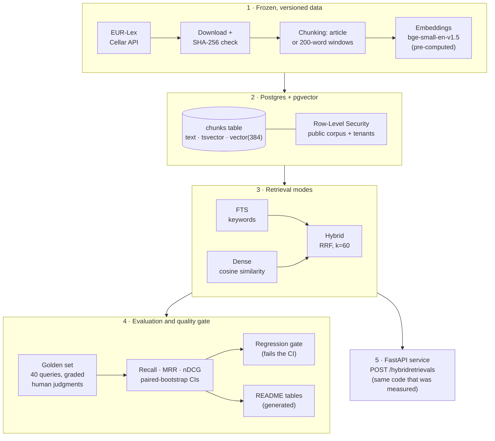

# Hybrid retrieval evaluation on EU financial legislation

**English** · [Español](README.es.md)

[](https://github.com/jcayama/HybridRetrieval-EU-FinancialLegislation/actions/workflows/ci.yml)  

> **Does hybrid search really beat keyword search?** This project measures it on three EU financial regulations, with a frozen test set labelled by a person, confidence intervals, and a plain account of what the data can and cannot show.

## TL;DR

**What it is.** A reproducible experiment that measures how well three ways of searching find the right article in
three EU financial regulations: AIFMD (Alternative Investment Fund Managers Directive), DORA (Digital Operational
Resilience Act) and the AI Act (Artificial Intelligence Act). The three ways are keyword search (Postgres full-text
search), semantic search (embeddings stored with pgvector) and a hybrid of both (Reciprocal Rank Fusion). It is built
on Postgres + pgvector and comes with a frozen, human-labelled test set, a regression gate in CI (continuous
integration), row-level tenant isolation and a small API you can query yourself.

**Headline results** (generated from `results/`; the full tables are in [Results](#results)):

<!-- tldr:start -->
- **Highest overall nDCG@10 among the main systems:** Hybrid FTS + dense, with 0.667 using windows (0.641 using articles), over 40 queries.
- **The only comparisons that survive the multiple-comparison correction:** Hybrid FTS + dense (article) − Postgres FTS (article) (+0.158 nDCG@10); Hybrid FTS + dense (window) − Postgres FTS (window) (+0.148 nDCG@10). Every other difference between the main systems is not detectable with 40 queries.
- **No single system wins on every query type** (window chunking, nDCG@10): paraphrase → Dense (bge-small) (0.666); exact term → BM25 (0.830); multi-article → Hybrid FTS + dense (0.710).

nDCG@10 and Recall@10 with window chunking:

| System | nDCG@10 | Recall@10 |
|---|---|---|
| BM25 | 0.584 | 0.744 |
| Postgres FTS | 0.519 | 0.762 |
| Dense (bge-small) | 0.644 | 0.771 |
| Hybrid FTS + dense | 0.667 | 0.867 |
| Hybrid BM25 + dense (exploratory) | 0.672 | 0.831 |
<!-- tldr:end -->

**How it fits together**



**Try it** (details in [Try the API](#try-the-api)):

```bash
docker compose up -d && python cli.py init-db && python cli.py load-db   # once; see "Development"
uvicorn main:app --port 5013                                             # then open http://localhost:5013/docs
```

**Example.** A question about reporting deadlines (response shortened: snippets cut, cosine rounded):

```bash
curl -s -X POST localhost:5013/hybridretrievals -H 'content-type: application/json' \
  -d '{"query": "How long do financial entities have to report a major ICT incident to the authority?", "top_k": 3}'
```

<!-- example:start -->
```json
{
  "query": "How long do financial entities have to report a major ICT incident to the authority?",
  "mode": "hybrid",
  "chunking": "window",
  "top_k": 3,
  "results": [
    {
      "rank": 1,
      "chunk_id": "32022R2554:art_19:w200:0",
      "act": "DORA 2022/2554",
      "celex": "32022R2554",
      "article": 19,
      "title": "Reporting of major ICT-related incidents and voluntary notification of significant cyber threats",
      "snippet": "1. Financial entities shall report major ICT-related incidents to the relevant competent…",
      "chunk_words": 200
    },
    {
      "rank": 2,
      "chunk_id": "32022R2554:art_17:w200:0",
      "act": "DORA 2022/2554",
      "celex": "32022R2554",
      "article": 17,
      "title": "ICT-related incident management process",
      "snippet": "1. Financial entities shall define, establish and implement an ICT-related incident…",
      "chunk_words": 200
    },
    {
      "rank": 3,
      "chunk_id": "32022R2554:art_18:w200:0",
      "act": "DORA 2022/2554",
      "celex": "32022R2554",
      "article": 18,
      "title": "Classification of ICT-related incidents and cyber threats",
      "snippet": "1. Financial entities shall classify ICT-related incidents and shall determine their…",
      "chunk_words": 200
    }
  ],
  "abstained": false,
  "best_cosine": 0.818
}
```
<!-- example:end -->

DORA Article 19 is the right article. Note that it points to the deadlines but does not state them: its paragraph 4 refers to time limits to be laid down in technical standards (Article 20), which are outside the corpus. The system retrieves articles; it does not answer questions.

A query unrelated to the corpus is not forced into results (see [Try the API](#try-the-api) for when this applies):

<!-- example-abstention:start -->
```json
{
  "query": "What is the best pizza recipe in Naples?",
  "mode": "hybrid",
  "chunking": "window",
  "top_k": 3,
  "results": [],
  "abstained": true,
  "best_cosine": 0.348
}
```
<!-- example-abstention:end -->

**What this project demonstrates**

- **Retrieval engineering:** lexical, dense and hybrid search with Reciprocal Rank Fusion, written by hand on
  Postgres + pgvector (no framework in the retriever).
- **Evaluation as engineering:** a frozen golden set, Recall / MRR / nDCG, paired-bootstrap confidence intervals,
  comparisons declared before computing them, a multiple-comparison correction, and exploratory results labelled as such.
- **Reproducibility:** a hashed corpus, a pinned model revision, versioned embeddings, and README tables that are
  generated by a script and checked in CI.
- **Quality gates:** a regression gate and tenant-isolation tests that fail the CI, with tests that were themselves
  verified by deliberately breaking the code (mutation checks).
- **Data security:** Row-Level Security with an unprivileged role and fail-closed policies, plus an honest list of what
  it does not cover.

**Limits worth knowing before you read on**

- 40 queries and a single annotator, without pooling: most differences between systems are **not statistically
  detectable** (see [Results](#results)).
- Only the articles are indexed (no recitals or annexes) and queries must be written in English.
- The API has no authentication and no connection pool: it is a demonstration, not a production service.

> **Status:** all seven goals below are implemented and measured, and the GitHub Actions CI has run successfully on
> the published history. If the regression gate ever failed because of platform differences, its thresholds would have
> to be recalibrated with the numbers it shows (see [Regression gate](#regression-gate)).

## What is evaluated

Seven goals, all implemented and measured:

1. Chunking by article versus fixed-size windows.
2. Postgres full-text search (FTS) versus dense search (pgvector) versus hybrid search with Reciprocal Rank Fusion (RRF).
3. Recall@K, MRR (Mean Reciprocal Rank) and nDCG@10 (normalized Discounted Cumulative Gain) on a frozen golden set of
   40 queries: 15 paraphrases, 15 exact terms and 10 multi-article queries with graded relevance.
4. HNSW versus IVFFlat indexes (recall and latency).
5. Multi-tenant isolation with Row-Level Security (RLS) and a test that fails on any leak.
6. A GitHub Actions workflow that fails if Recall@K drops below a threshold or if the RLS test detects a leak.
7. Unit tests of the evaluator with a hand-worked example (also cross-checked against scikit-learn).

## Corpus

Published (not consolidated) text of three EU acts, downloaded from the EUR-Lex Cellar API:

| Act | CELEX |
|-----|-------|
| AIFMD Directive 2011/61/EU | 32011L0061 |
| DORA Regulation (EU) 2022/2554 | 32022R2554 |
| AI Act, Regulation (EU) 2024/1689 | 32024R1689 |

The corpus is frozen by storing the SHA-256 hash of each download and versioning the chunks as JSONL.

- `data/raw/`: HTML downloaded from EUR-Lex. **Not versioned**: it is downloaded again and validated against the hash.
- `data/corpus.sha256`: the frozen hashes of the corpus. It **is** versioned and guarantees that everybody works on the
  same text.
- `data/abstention/`: 20 unanswerable queries (10 off-topic, 10 near-domain) used to study abstention. Their "no answer in the corpus" status is stated by the author, they are frozen with a hash and are **not** part of the golden set.
- `data/chunks/`: chunks as JSONL (`articles.jsonl` and `windows_w200_o40.jsonl`). They **are** versioned. A test checks
  that regenerating them from the frozen corpus gives exactly the same files (that test needs the downloaded HTML, so
  it runs locally and is skipped in the CI).

**Data and privacy.** Only public or synthetic data is used. There is no customer data in this repository.

## Results

What to read from this section, and what not to:

- **A single person judged relevance** for **40 queries** over a corpus of 248 articles, without pooling, so small
  differences between systems are **not statistically solid**. The intervals come from a paired bootstrap over
  queries and do not capture the variability between builds of an approximate index.
- The **primary comparisons** were declared before computing them; the **exploratory** ones (ideas that came after
  seeing results) are reported separately and with a stricter correction. With so many comparisons, it is to be
  expected that some will exclude zero at 95% by chance: that is why the Bonferroni correction is also shown.
- The metrics use relevant = grade ≥ 2 for Recall and MRR, and linear gain in nDCG (see
  [Evaluation method](#golden-set-and-evaluation-method)).
- The whole block below is written by `python cli.py report`; `python cli.py report --check` fails if it is out of
  date.

<details>
<summary>Full result tables (click to expand)</summary>

<!-- results:start -->
#### Overall metrics (40 queries)

| System | Chunking | Recall@1 | Recall@3 | Recall@5 | Recall@10 | nDCG@10 [95% CI] | MRR@10 |
|---|---|---|---|---|---|---|---|
| BM25 | article | 0.252 | 0.431 | 0.598 | 0.727 | 0.545 [0.443, 0.647] | 0.544 |
| BM25 | window | 0.310 | 0.552 | 0.585 | 0.744 | 0.584 [0.475, 0.689] | 0.608 |
| Postgres FTS | article | 0.237 | 0.371 | 0.496 | 0.675 | 0.483 [0.377, 0.593] | 0.464 |
| Postgres FTS | window | 0.242 | 0.369 | 0.523 | 0.762 | 0.519 [0.420, 0.619] | 0.507 |
| Dense (bge-small) | article | 0.327 | 0.500 | 0.604 | 0.690 | 0.555 [0.451, 0.658] | 0.623 |
| Dense (bge-small) | window | 0.377 | 0.598 | 0.640 | 0.771 | 0.644 [0.546, 0.740] | 0.688 |
| Hybrid FTS + dense | article | 0.340 | 0.515 | 0.683 | 0.827 | 0.641 [0.555, 0.725] | 0.675 |
| Hybrid FTS + dense | window | 0.369 | 0.577 | 0.673 | 0.867 | 0.667 [0.575, 0.759] | 0.693 |
| Hybrid BM25 + dense (exploratory) | article | 0.356 | 0.510 | 0.644 | 0.767 | 0.615 [0.519, 0.709] | 0.696 |
| Hybrid BM25 + dense (exploratory) | window | 0.365 | 0.613 | 0.690 | 0.831 | 0.672 [0.586, 0.759] | 0.726 |

#### nDCG@10 by query type

| System | Chunking | Paraphrase (15) | Exact term (15) | Multi-article (10) |
|---|---|---|---|---|
| BM25 | article | 0.384 | 0.727 | 0.515 |
| BM25 | window | 0.378 | 0.830 | 0.521 |
| Postgres FTS | article | 0.425 | 0.617 | 0.369 |
| Postgres FTS | window | 0.366 | 0.613 | 0.606 |
| Dense (bge-small) | article | 0.688 | 0.360 | 0.649 |
| Dense (bge-small) | window | 0.666 | 0.619 | 0.649 |
| Hybrid FTS + dense | article | 0.702 | 0.575 | 0.651 |
| Hybrid FTS + dense | window | 0.640 | 0.665 | 0.710 |
| Hybrid BM25 + dense (exploratory) | article | 0.613 | 0.592 | 0.652 |
| Hybrid BM25 + dense (exploratory) | window | 0.566 | 0.770 | 0.685 |

#### Primary comparisons (overall nDCG@10, paired bootstrap over queries)

- With article chunking, the highest overall nDCG@10 among the main systems is **Hybrid FTS + dense** (0.641).
- With window chunking, the highest overall nDCG@10 among the main systems is **Hybrid FTS + dense** (0.667).
- Having the highest figure does **not imply** that the difference is detectable: what counts are the comparisons below, not the order of the tables.
- Of the 15 primary comparisons, **5** exclude zero with a 95% CI and **2** still exclude it after the Bonferroni correction for 15.
- Those that survive the correction are: **Hybrid FTS + dense (article) − Postgres FTS (article)**; **Hybrid FTS + dense (window) − Postgres FTS (window)**.
- Exclude zero only at 95%, without correction (hints, not findings): Dense (bge-small) (window) − Postgres FTS (window); Dense (bge-small) (window) − Dense (bge-small) (article); Hybrid FTS + dense (article) − Dense (bge-small) (article).

| Comparison (A − B) | nDCG@10 diff. | 95% CI | Bonferroni CI (15) | Excludes 0 (95%) | Excludes 0 (Bonferroni) |
|---|---|---|---|---|---|
| BM25 (article) − Postgres FTS (article) | +0.062 | [−0.039, +0.162] | [−0.096, +0.214] | no | no |
| BM25 (window) − Postgres FTS (window) | +0.065 | [−0.026, +0.163] | [−0.065, +0.212] | no | no |
| Postgres FTS (window) − Postgres FTS (article) | +0.036 | [−0.045, +0.117] | [−0.087, +0.158] | no | no |
| BM25 (window) − BM25 (article) | +0.039 | [−0.005, +0.080] | [−0.029, +0.101] | no | no |
| Dense (bge-small) (article) − BM25 (article) | +0.010 | [−0.138, +0.152] | [−0.210, +0.218] | no | no |
| Dense (bge-small) (window) − BM25 (window) | +0.061 | [−0.074, +0.191] | [−0.142, +0.254] | no | no |
| Dense (bge-small) (article) − Postgres FTS (article) | +0.072 | [−0.081, +0.219] | [−0.161, +0.287] | no | no |
| Dense (bge-small) (window) − Postgres FTS (window) | +0.125 | [+0.011, +0.233] | [−0.052, +0.285] | yes | no |
| Dense (bge-small) (window) − Dense (bge-small) (article) | +0.089 | [+0.014, +0.177] | [−0.014, +0.229] | yes | no |
| Hybrid FTS + dense (article) − Dense (bge-small) (article) | +0.086 | [+0.015, +0.162] | [−0.021, +0.198] | yes | no |
| Hybrid FTS + dense (window) − Dense (bge-small) (window) | +0.023 | [−0.048, +0.095] | [−0.081, +0.137] | no | no |
| Hybrid FTS + dense (article) − Postgres FTS (article) | +0.158 | [+0.059, +0.255] | [+0.016, +0.300] | yes | **yes** |
| Hybrid FTS + dense (window) − Postgres FTS (window) | +0.148 | [+0.068, +0.232] | [+0.025, +0.278] | yes | **yes** |
| Hybrid FTS + dense (article) − BM25 (article) | +0.097 | [−0.016, +0.209] | [−0.072, +0.266] | no | no |
| Hybrid FTS + dense (window) − BM25 (window) | +0.083 | [−0.033, +0.202] | [−0.093, +0.256] | no | no |

#### Exploratory comparisons (ideas that came after seeing the results)

Bonferroni correction over 21 (the 15 primary comparisons plus these 6). 1 of 6 exclude zero at 95% and 0 after the correction.

| Comparison (A − B) | nDCG@10 diff. | 95% CI | Bonferroni CI (21) | Excludes 0 (95%) | Excludes 0 (Bonferroni) |
|---|---|---|---|---|---|
| Hybrid BM25 + dense (exploratory) (article) − BM25 (article) | +0.070 | [−0.016, +0.154] | [−0.060, +0.198] | no | no |
| Hybrid BM25 + dense (exploratory) (article) − Dense (bge-small) (article) | +0.060 | [−0.022, +0.145] | [−0.068, +0.193] | no | no |
| Hybrid BM25 + dense (exploratory) (article) − Hybrid FTS + dense (article) | −0.026 | [−0.101, +0.037] | [−0.142, +0.064] | no | no |
| Hybrid BM25 + dense (exploratory) (window) − BM25 (window) | +0.089 | [+0.008, +0.166] | [−0.035, +0.213] | yes | no |
| Hybrid BM25 + dense (exploratory) (window) − Dense (bge-small) (window) | +0.028 | [−0.046, +0.104] | [−0.087, +0.145] | no | no |
| Hybrid BM25 + dense (exploratory) (window) − Hybrid FTS + dense (window) | +0.005 | [−0.072, +0.084] | [−0.115, +0.121] | no | no |

#### Regression gate (margin 0.010, manual decision)

| Chunking | Metric | Value at calibration | Threshold |
|---|---|---|---|
| article | recall@10 | 0.827 | 0.815 |
| article | ndcg@10 | 0.641 | 0.630 |
| window | recall@10 | 0.867 | 0.855 |
| window | ndcg@10 | 0.667 | 0.655 |

#### Approximate indexes (recall@10 against exact search, and median latency)

| Dataset | Method | Parameters | Recall@10 | Latency (ms) | Build (s) | Index (MB) |
|---|---|---|---|---|---|---|
| Real corpus, window (719 rows) | Exact (reference) | — | 1.000 | 0.78 | — | — |
|  | HNSW (ef_search=40) | ef_construction=64, m=16 | 0.995 | 0.84 | 0.1 | 1.5 |
|  | IVFFlat (probes=1) | lists=27 | 0.562 | 0.77 | 0.0 | 1.3 |
|  | IVFFlat (probes=10) | lists=27 | 0.963 | 0.74 | 0.0 | 1.3 |
| Real corpus, article (248 rows) | Exact (reference) | — | 1.000 | 0.74 | — | — |
|  | HNSW (ef_search=40) | ef_construction=64, m=16 | 1.000 | 0.90 | 0.0 | 0.5 |
|  | IVFFlat (probes=1) | lists=16 | 0.575 | 0.62 | 0.0 | 0.5 |
|  | IVFFlat (probes=10) | lists=16 | 0.983 | 0.65 | 0.0 | 0.5 |
| Synthetic (100,000 rows) | Exact (reference) | — | 1.000 | 32.81 | — | — |
|  | HNSW (ef_search=40) | ef_construction=64, m=16 | 0.993 | 1.35 | 31.6 | 204.8 |
|  | IVFFlat (probes=1) | lists=100 | 0.998 | 1.46 | 2.6 | 164.3 |
|  | IVFFlat (probes=10) | lists=100 | 1.000 | 6.83 | 2.6 | 164.3 |

#### Error analysis (the hybrid's bad queries)

A query is **bad** for a chunking if the hybrid's nDCG@10 is below 0.3 or there is no relevant article (grade ≥ 2) in the top 10: 8 cases, from 5 distinct queries. Each case is contrasted with a **probe**: the same query with **a single change**. Per-case detail (positions, terms, frequencies) is in `results/error_analysis.json`, generated with `python cli.py error-analysis`.

| Query | Type | Chunking | Hybrid nDCG@10 (original → probe) | Position of the most relevant article in the hybrid | Probe change and what it tests | Effect |
|---|---|---|---|---|---|---|
| q006: How are the technology suppliers that financial firms depend on most identified and supervised? | Multi-article | article | 0.211 → 0.697 | DORA 31: 4 → 1 | «technology suppliers» → «ICT third-party service providers» (the text uses different words than the query) | explains the failure |
| q018: stress tests | Exact term | article | 0.076 → 0.821 | AIFMD 15: 25 → 2 | FTS with AND (`stress & test`) instead of OR (`ts_rank_cd` does not weigh how rare a term is) | explains the failure |
| q029: Can companies try out new AI systems under official supervision before placing them on the market? | Paraphrase | article | 0.120 → 1.000 | AI Act 57: 13 → 1 | add «regulatory sandbox» (the paraphrase avoids the term the law uses) | explains the failure |
| q036: register of information | Exact term | article | 0.000 → 1.000 | DORA 28: 72 → 1 | FTS with proximity (`regist <2> inform`) (FTS does not treat the phrase as a unit) | explains the failure |
| q006: How are the technology suppliers that financial firms depend on most identified and supervised? | Multi-article | window | 0.245 → 0.687 | DORA 31: 3 → 1 | «technology suppliers» → «ICT third-party service providers» (the text uses different words than the query) | explains the failure |
| q018: stress tests | Exact term | window | 0.070 → 0.821 | AIFMD 15: 17 → 2 | FTS with AND (`stress & test`) instead of OR (`ts_rank_cd` does not weigh how rare a term is) | explains the failure |
| q028: How large can the fines be for companies that break the AI rules? | Paraphrase | window | 0.289 → 1.000 | AI Act 99: 10 → 1 | remove «AI» from the query (a generic term present in many chunks dominates FTS) | explains the failure |
| q029: Can companies try out new AI systems under official supervision before placing them on the market? | Paraphrase | window | 0.000 → 0.945 | AI Act 57: 18 → 1 | add «regulatory sandbox» (the paraphrase avoids the term the law uses) | explains the failure |

- Probe effect (rule fixed before computing): **explains the failure** if the hybrid's nDCG@10 rises by at least 0.1; **partial** if it rises by less; **no effect** if it does not rise. A probe explaining a query's nDCG@10 does not mean that all its judged articles are retrieved: per-article positions are in the JSON.
- The probes were written **knowing which article is relevant**: they show that a cause is *sufficient* to explain the failure, not that the change improves the system in general. They are not used to modify the system or the golden set.
- A retrieved article that the golden set did not judge counts as a miss (see "No pooling"): some of these cases may be an incomplete judgment rather than a system error. Deciding that belongs to whoever sets the judgments.
- Few queries and a single annotator: they describe these cases and do not allow generalizing.

#### Abstention: cosine of the best chunk (golden set versus unanswerable queries)

Could a threshold on the best chunk's cosine make the retriever abstain on queries with no answer? The cosine of the 40 golden-set queries (answerable) is compared with that of 20 unanswerable queries (10 off-topic and 10 "near-domain", outside the corpus), set by whoever sets the judgments, in `data/abstention/` (frozen with a hash). It is computed with `python cli.py abstention`; the API applies the proposed threshold with windows (`data/abstention/threshold.json`, rounded down to thousandths) in `dense` and `hybrid`, only to discard clearly unrelated queries; with articles it does not abstain, because there the threshold rejects legitimate queries.

| Chunking | Group | Queries | Minimum cosine | Median | Maximum |
|---|---|---|---|---|---|
| article | Golden set (answerable) | 40 | 0.518 | 0.707 | 0.859 |
| article | Unanswerable, off-topic | 10 | 0.348 | 0.441 | 0.557 |
| article | Unanswerable, near-domain | 10 | 0.621 | 0.664 | 0.701 |
| window | Golden set (answerable) | 40 | 0.556 | 0.722 | 0.845 |
| window | Unanswerable, off-topic | 10 | 0.348 | 0.444 | 0.549 |
| window | Unanswerable, near-domain | 10 | 0.611 | 0.679 | 0.712 |

| Chunking | Golden set versus… | AUC [95% CI] |
|---|---|---|
| article | all unanswerable queries | 0.868 [0.769, 0.944] |
| article | off-topic only | 0.995 [0.978, 1.000] |
| article | near-domain only | 0.740 [0.600, 0.865] |
| window | all unanswerable queries | 0.876 [0.779, 0.949] |
| window | off-topic only | 1.000 [1.000, 1.000] |
| window | near-domain only | 0.752 [0.613, 0.873] |

| Chunking | Threshold | Golden set kept | Off-topic rejected | Near-domain rejected |
|---|---|---|---|---|
| article | 0.50 | 40/40 | 8/10 | 0/10 |
| article | 0.54 | 39/40 | 9/10 | 0/10 |
| article | 0.58 | 38/40 | 10/10 | 0/10 |
| article | 0.62 | 33/40 | 10/10 | 0/10 |
| article | 0.66 | 31/40 | 10/10 | 4/10 |
| article | 0.70 | 22/40 | 10/10 | 9/10 |
| article | 0.74 | 11/40 | 10/10 | 10/10 |
| article | 0.78 | 5/40 | 10/10 | 10/10 |
| window | 0.50 | 40/40 | 7/10 | 0/10 |
| window | 0.54 | 40/40 | 9/10 | 0/10 |
| window | 0.58 | 39/40 | 10/10 | 0/10 |
| window | 0.62 | 36/40 | 10/10 | 1/10 |
| window | 0.66 | 33/40 | 10/10 | 3/10 |
| window | 0.70 | 26/40 | 10/10 | 8/10 |
| window | 0.74 | 14/40 | 10/10 | 10/10 |
| window | 0.78 | 7/40 | 10/10 | 10/10 |

With article chunking, the threshold that keeps at least 95% of the golden set (rule fixed before computing) is **0.589**: it keeps 38 of 40 queries, rejects 10 of 10 off-topic and 0 of 10 near-domain. Golden-set queries it would reject: q021 «letter-box» (0.540); q031 «deep fake» (0.518).

With window chunking, the threshold that keeps at least 95% of the golden set (rule fixed before computing) is **0.610**: it keeps 38 of 40 queries, rejects 10 of 10 off-topic and 0 of 10 near-domain. Golden-set queries it would reject: q021 «letter-box» (0.556); q030 «floating point operations» (0.609).

- The AUC is the probability that an answerable query has a higher cosine than an unanswerable one (0.5 = indistinguishable; 1 = fully separated). If the groups do not overlap in the sample, the bootstrap gives a degenerate CI at 1.000: it does not measure real uncertainty, only that these queries do not overlap.
- The golden-set queries were written "from the article", so their cosine is higher than a real user's; and the threshold is calibrated on the same queries it is evaluated on. Both make it optimistic.
- That the unanswerable queries have no answer in the corpus is stated by whoever sets the judgments, not by a script. With 40 and 20 queries the intervals are wide: it is a hint, not a final threshold.
<!-- results:end -->

</details>

## Try the API

```bash
docker compose up -d && python cli.py init-db && python cli.py load-db   # once (see "Development")
uvicorn main:app --port 5013
```

Open <http://localhost:5013/docs> (interactive interface) or use `curl`:

```bash
curl -s -X POST localhost:5013/hybridretrievals -H 'content-type: application/json' \
  -d '{"query": "What must a bank write into its contract with a cloud provider?", "top_k": 5}'
```

| Field | Values | Default |
|---|---|---|
| `query` | 1 to 500 characters, **in English**; short acronyms (`TLPT`) are valid | — |
| `top_k` | 1 to 50 distinct articles | 10 |
| `mode` | `hybrid` (FTS + dense with RRF k=60), `fts`, `dense` | `hybrid` |
| `chunking` | `window` (200-word windows), `article` | `window` |

Each result carries `rank`, `chunk_id`, `act`, `celex`, `article`, `title`, a `snippet` of about 400 characters and
`chunk_words` (the size of the returned chunk). `GET /health` reports whether the database and the model are responding.

- **Abstention (only for clearly unrelated queries):** in `dense` and `hybrid`, if the cosine of the best chunk is below a
  threshold (`data/abstention/threshold.json`: 0.609, calibrated as described in [Results](#results)) **and
  `chunking=window`**, the answer is a `200` with `results: []`, `abstained: true` and the `best_cosine` that explains it.
  `fts` never abstains and needs no model. It is on by default; `API_ENABLE_ABSTENTION=false` turns it off, and `/health`
  reports `abstention`. **It only discards queries that are clearly outside the corpus** (pizza, football): it does not
  detect near-domain ones (MiFID, Basel), and it can wrongly reject short exact-term queries: it rejects 2 of the 40
  golden-set queries. With `chunking=article` it does **not** abstain: there the threshold also rejected legitimate queries
  such as `social scoring` (a real AI Act term) and the groups overlap more.
- **What the snippet is:** with `chunking=window` it is the start of the best-matching window. With `chunking=article` the
  chunk is the whole article (`chunk_id` ends in `art_N`), so the snippet is the **passage that best matches the query
  words** (Postgres `ts_headline`), with «…» where it is cut; if the query shares no words with the article (for example in
  `dense` mode) it falls back to the start of the article. Article snippets cost more time than window ones because
  `ts_headline` processes whole articles (not benchmarked).

- **Two installation levels:** with `requirements.txt` (no torch) `mode=fts` works. `hybrid` and `dense` embed the
  query with the model and need `pip install -r requirements-embeddings.txt` (torch, hundreds of MB); without it they
  return a **503** that explains why. The model is loaded when the server starts, outside the event loop.
- **What guarantees the endpoint does what was measured:** `tests/test_api_parity.py` checks that, for the 40 golden-set
  queries, the endpoint returns **exactly** the rankings that `evaluate` measured, with FTS, dense and hybrid and with
  both chunkings. The CI runs the FTS part; the parts that need the model run only locally.
- **Errors** (`{"errors": [{"code", "title"}]}`): `E0001` empty query or longer than 500 characters (400), `E0002`
  model unavailable (503), `E0003` invalid `X-Tenant-ID` header (400), `E0004` database unavailable or not loaded
  (503). Malformed bodies give FastAPI's usual 422. Unexpected failures give a 500 with an `error_id` and no internal
  details.
- **Tenants (a demonstration, not security):** by default only the public corpus is visible and the header is ignored.
  With `API_ENABLE_TENANTS=true`, `X-Tenant-ID` activates RLS isolation (see
  [Multi-tenant isolation](#multi-tenant-isolation-rls)). **There is no authentication: anyone can claim any tenant**,
  so it must not be used to protect real data.
- **Known limits:** abstention is a single cosine threshold, not a relevance judgment; every request opens its own connections (no pool); the handler is asynchronous but calls the
  pipeline's synchronous code in a thread (`asyncio.to_thread`) instead of using `AsyncConnection`; no authentication
  or rate limiting; CORS only for `https://localhost:5013`; per-request latency has not been measured.

## How it works

### Chunking

<details>
<summary>Show details</summary>

- **Scope:** articles only (248: AIFMD 71, DORA 64, AI Act 113). Recitals and annexes are left out.
- **By article:** one chunk per article, with the header `Article N. Title`.
- **By windows:** 200 words of the body with an overlap of 40, never crossing an article boundary; if the remaining
  tail has fewer than 50 new words it is merged into the previous window. Every window starts with the header
  `Article N. Title` (its words do not count towards the 200).
- **Fidelity:** the text is literal; only whitespace is normalized. The rows of `(a) ...` lists are joined into one line.
- **Evaluation:** relevance judgments are given per article (`celex` + `article`), so both strategies are measured
  with the same judgments.

</details>

### Embeddings

<details>
<summary>Show details</summary>

- **Model:** `BAAI/bge-small-en-v1.5` (MIT, 384 dimensions, 512-token window) pinned by commit hash (`5c38ec7c…`).
  Chosen with criteria decided before measuring (window, licence, size, configuration risk); it was not compared with
  others on the golden set. `all-MiniLM-L6-v2` was discarded because of its 256-token window.
- **Queries** carry the model's retrieval instruction; **chunks** carry no prefix. Vectors are normalized (L2).
- **Pre-computed and versioned** in `data/embeddings/` with a `manifest.json` (model, revision, library versions and the
  hashes of each file and of its source). `load_embeddings` refuses to return stale vectors. The API and the CI do not
  need torch; only `python cli.py embed` needs `pip install -r requirements-embeddings.txt`.
- **Truncation, measured** with the real tokenizer: **108 of the 248 articles (44%) exceed 512 tokens** and are
  truncated (on average they lose 36% of their tokens); **none of the 719 windows** is truncated (maximum 416 tokens).
  It is a property of "one chunk per article" combined with a model of fixed context length.
- Vectors can differ in the last decimal between platforms; that is why `--verify` requires cosine >= 0.9999 and not
  bit-for-bit equality.

</details>

### Retrieval systems on Postgres

<details>
<summary>Show details</summary>

- **FTS** (`scripts/fts.py`): configuration `'english'`; query = OR of the terms (by default Postgres requires all of
  them); ranking `ts_rank_cd` with default values; ties broken by `chunk_id`. Decisions fixed before measuring.
- **Dense** (`scripts/dense.py`): column `embedding vector(384)` in the same `chunks` table; cosine distance (`<=>`) with
  **exact search, no approximate index**; ties broken by `chunk_id`. `load-db` also loads the vectors from
  `data/embeddings/` (and refuses if they are stale) and `evaluate --system dense` uses the pre-computed vectors of the
  golden-set queries, so it does not need torch. The `vector` extension is always installed in the `public` schema.
- **Hybrid** (`scripts/rrf.py` and `scripts/hybrid.py`): RRF with k = 60 over the FTS and dense rankings, each with its
  200 best chunks. Fusion happens **at chunk level** (by `chunk_id`) and the result is then converted to distinct
  articles, exactly like in the other systems. RRF is a pure function with tests (including a hand-computed example).
- **Hybrid BM25 + dense** (`--system hybrid-bm25`, **exploratory**): the same RRF fusion with BM25 as the lexical input.
  It is an idea that came after seeing the results of the FTS hybrid, so its comparisons were declared exploratory and
  corrected with Bonferroni over 21 (the 15 primary ones plus these 6). The result is reported as it is; it does not
  change the main system.
- `evaluate --system fts|dense|hybrid|hybrid-bm25` refuses to run if the chunks (and, for dense, the embeddings) loaded
  in the database do not match `data/chunks/` (repeat `load-db`).
- Database tests use an isolated temporary schema and skip themselves when there is no Postgres (in the CI they fail
  instead).

</details>

### Golden set and evaluation method

<details>
<summary>Show details</summary>

- `data/golden/queries.jsonl`: queries (`query_id`, `type`, `theme`, `query`). Types: `paraphrase`, `exact_term` and
  `multi_article`. Queries are in English, like the corpus.
- `data/golden/qrels.jsonl`: relevance judgments, **one line per query-article pair** (`query_id`, `celex`, `article`,
  `grade`). They are written by a person; no LLM labels.
- **Scale:** 3 = the article answers directly; 2 = contributes a substantial part; 1 = related but tangential;
  unwritten = not relevant. The grade measures how much that article covers by itself, not the order in which it
  should appear; several articles can share a grade.
- **Inclusion criterion:** an article gets a judgment if it **deals with** the concept of the query, not for merely
  mentioning it in passing. That is why some articles contain the term of an `exact_term` query and have no judgment;
  `validate-golden` lists them as information for review.
- **Method:** queries written "from the article", judged by reading the text, without the help of any search engine,
  and frozen before running any retrieval.
- **Limitations:** a small set (40 queries) and a single annotator; the "from the article" method slightly favours the
  source article. Small differences between systems will not be statistically solid.
- **No pooling (an explicit decision):** the judgments are the independent ones from phase 1; no pooling round was run.
  A relevant article that the golden set did not judge counts as a failure of the system that retrieves it, so
  **absolute recall may be underestimated**, and not necessarily equally for all systems: those that retrieve relevant
  articles different from the judged ones may be penalized. Measured: the top 10 of the 10 evaluated systems (5 × 2
  chunkings) leaves **913 query-article pairs without judgment**, covering 217 of the corpus's 248 articles; the fraction
  that is relevant was not estimated. Judging them all would have meant about 723,000 words of reading, and it was
  discarded because of its cost. Differences between systems must be read with this caution.

**Evaluation method.** The metrics live in `scripts/metrics.py` as pure functions, with hand-worked tests
(`tests/test_metrics.py`). Decisions fixed **before** running any retrieval:

- **Unit:** the article. Chunk rankings (windows) are converted to distinct articles, keeping the best position of each.
- **Relevant** (Recall and MRR): grade >= 2. Grade 1 only counts in nDCG.
- **Metrics:** Recall@1, @3, @5 and @10, MRR@10 and nDCG@10 with linear gain (3, 2, 1). The exponential gain (7, 3, 1)
  remains as a sensitivity analysis.
- **Uncertainty:** paired bootstrap over queries (10,000 resamples, fixed seed, 95% percentile interval), also per
  query type. With 15, 15 and 10 queries per type, the intervals will be wide.

Hand-worked example (judgments A=3, B=2, C=1; ranking X, B, A, Y, C with X and Y irrelevant): Recall@1 = 0,
Recall@2 = 0.5, Recall@3 = 1, MRR = 0.5 and nDCG@5 = 0.6612 (DCG = 2/log2(3) + 3/log2(4) + 1/log2(6) = 3.1487; ideal
A, B, C = 4.7619).

</details>

### Approximate indexes: HNSW versus IVFFlat

<details>
<summary>Show details</summary>

`python cli.py bench-index` measures recall against **Postgres exact search** (the reference) and latency, with
parameters fixed before measuring: HNSW `m=16`, `ef_construction=64` and a sweep of `ef_search`; IVFFlat with
`lists = rows/1000` (pgvector's guideline) and a sweep of `probes`. The full figures are in
`results/index_benchmark.json`. Two parts, with different limits:

- **Real corpus (719 windows and 248 articles):** at this scale **exact search is as fast as any index** (≈0.7–0.8 ms in
  every case, where the fixed cost of the query dominates), so indexes bring nothing in latency. They do show recall:
  HNSW with `ef_search=40` ≥ 0.995 and IVFFlat with `probes=1` between 0.56 and 0.58, with queries that return fewer
  than 10 results.
- **Synthetic scale (100,000 vectors):** **synthetic** data (perturbations of real vectors with cosine 0.93 to their
  origin, calibrated with the cosine to the 10 nearest neighbours of the real windows). Exact search takes ≈33 ms;
  HNSW with `ef_search=40` ≈1.4 ms with recall ≈0.99; IVFFlat with `probes=1` ≈1.5 ms with recall ≈0.998. **It cannot
  be concluded from here that IVFFlat is better:** this data is 719 very marked "clouds", which favour IVFFlat, and on
  the real corpus IVFFlat with `probes=1` performed much worse. What the comparison does show is that HNSW's recall was
  ≥ 0.95 on the three datasets with any `ef_search`, while IVFFlat's depends strongly on the data and on `probes`.
- **Variance between builds:** rebuilding the HNSW graph (without parallelism) gave recall 0.993 and 0.975 with
  `ef_search=40`. Differences between nearby `ef_search` values are smaller than that variance and must not be
  interpreted. The benchmark's intervals cover the variability between queries, not between builds.
- **Operational effect:** HNSW returns at most `ef_search` rows. With `ef_search=10`, the golden set's nDCG@10 with
  windows drops from 0.644 to 0.571, because the ranking does not reach 10 distinct articles; with 40 it matches exact
  search. IVFFlat with `probes=1` loses ≈0.2 of nDCG.
- **Decision for this project:** with ~1,000 vectors **exact** search is kept (and the CI's regression gate uses exact
  search). If the corpus grew, the recommendation would be HNSW with `ef_search >= 40`.
- **Infrastructure:** in Docker containers (`/dev/shm` of 64 MB by default) a parallel build with a high
  `maintenance_work_mem` fails with "could not resize shared memory segment"; the benchmark builds without
  parallelism. GitHub's CI has the same limit.
- **Latency:** measured end to end from Python (it includes serializing the 384-number vector), with `shared_buffers`
  of 128 MB and the container sharing CPU with other processes on the machine.

</details>

### Multi-tenant isolation (RLS)

<details>
<summary>Show details</summary>

Model: the legislative corpus is public and belongs to nobody; each tenant can also have **private synthetic
documents** (`tenant_id`). `NULL` in `tenant_id` is the public corpus. All test data is synthetic.

- **Policies** on `chunks` (one per operation): `SELECT` sees the public corpus and one's own rows; `INSERT` only with
  one's own `tenant_id`; `UPDATE` and `DELETE` only on one's own rows (a tenant **cannot modify or delete the public
  corpus**, nor reassign its rows to another tenant). If no tenant is set, **zero rows**, not even the public ones
  (fail-closed).
- **Role `app_user`** without privileges (not a superuser, no `BYPASSRLS`, not the owner) and
  `FORCE ROW LEVEL SECURITY`.
- **Use:** `db.tenant_transaction(conn, tenant_id)` at the start of each request runs `SET LOCAL ROLE app_user` and
  `set_config('app.tenant_id', …, true)`. Both last only until the end of the transaction, so they do not survive on a
  reused pooled connection; a session-level setting (`is_local = false`) would leak the previous tenant, and a control
  test demonstrates it. `SET LOCAL x = %s` does not accept bound parameters in psycopg 3; that is why `set_config`.
- **Searches:** `FtsIndex`, `DenseIndex` and `HybridIndex` accept `tenant=`. Without a tenant (the golden-set
  evaluation) they only see the public corpus. `load-db` deletes only the public rows when reloading.
- **Tests** (`tests/test_rls.py`, against a real Postgres): each tenant sees the public data and its own and never
  anyone else's; with no tenant it sees nothing; writes are confined; the tenant and the role do not survive the
  transaction; FTS, dense and hybrid searches do not leak. Checked with mutations (session instead of transaction, a
  policy that does not require a tenant, `UPDATE` on public rows, `INSERT` without a check, RLS disabled, etc.): all
  are detected.
- **HNSW + RLS:** the approximate index hands over its candidates before the RLS filter. With 200 rows of tenant A
  right next to the query and 3,000 public rows far away, tenant B with `ef_search=40` (the default) receives **0 rows**
  (never rows of A, but not the 10 requested either). With `ef_search=200` or with
  `hnsw.iterative_scan = relaxed_order` it receives the 10, all public, just like with exact search. The case is
  designed to show the problem; the real magnitude depends on the data. It is one more reason to keep exact search with
  this corpus.

Limitations of this implementation, to keep in mind:

- **Main weakness:** if the application connects as the owner and calls `tenant_transaction`, **forgetting to call it**
  leaves that request with the owner's privileges, which sees everything. In production the API should connect directly
  with a `LOGIN` role that inherits from `app_user`, so that forgetting to set the tenant gives zero rows. That
  connection setup is not implemented yet nor integrated with FastAPI.
- `FORCE ROW LEVEL SECURITY` is only verified through the catalog: the test connection is a superuser and superusers
  always bypass RLS, so its effect cannot be checked behaviourally.
- `app.tenant_id` is a configuration parameter that the session itself can modify: an SQL injection could change it.
  The defence is to always use parameterized queries; it is not covered here.
- If the owner were not a superuser, `FORCE` would apply the policies to it and loading would need `BYPASSRLS`.

</details>

### Regression gate

<details>
<summary>Show details</summary>

`python cli.py gate` evaluates the main system (**FTS + dense hybrid with RRF k=60, exact search**) on the frozen golden
set and fails if **Recall@10 or nDCG@10**, with article or window chunking, fall below the thresholds in
`data/gate/thresholds.json`. The CI runs it together with the RLS tests.

- **What it is and what it is not:** a gate **does not compare systems statistically** (the golden set's sampling CI is
  ±0.1): it detects that the pipeline has changed its behaviour on the same frozen data. That is why the margin depends
  on implementation and platform noise, not on sampling noise.
- **Rule** (fixed before computing, `scripts/gate.py`): noise = the larger of the between-environment difference
  observed for FTS (0.008) and the largest change of the hybrid when query vectors are perturbed; margin =
  max(0.01, 3 × noise) rounded up to multiples of 0.005; threshold = current value − margin, rounded down. The
  thresholds are recomputed with `python cli.py calibrate-gate [--write-thresholds]`, and
  `python cli.py gate-margin X` sets a margin decided by hand. Everything is stored in `results/gate_calibration.json`.
- **Noise, measured:** perturbing the query vectors with a relative noise of 1e-6 and 1e-5 (100 times the `float32`
  epsilon) did not move any metric across 20 seeds; metrics start to move at ≈1e-3 (nDCG by up to 0.003) and at 1e-2
  Recall@10 changes by up to 0.025. The difference between Homebrew's PostgreSQL and the container, measured once for
  FTS, was up to 0.008 (in Recall@3, which is not a gate metric) and ≤0.001 in Recall@10 and nDCG@10. **The gate
  passed on GitHub Actions** with this margin. The run's log was not inspected, so it is not documented which
  architecture the runner used nor which values it measured: if it ever fails because of the platform, the log itself
  will show them.
- **Sensitivity** (in `results/gate_calibration.json`): the gate detects queries misaligned with their vectors, changing
  the FTS configuration to `'simple'`, degrading the hybrid to dense-only or FTS-only, and changing RRF to k=1 with
  windows. **With a margin of 0.025 it would not detect** queries losing the model's instruction with windows (−0.014
  nDCG) nor RRF with k=1000 with articles.
- **Limits:** it protects the current corpus and golden set; it does not detect improvements nor regressions smaller
  than the margin, and it does not replace `evaluate` and `compare` for choosing between systems.

</details>

### Continuous integration (GitHub Actions)

<details>
<summary>Show details</summary>

`.github/workflows/ci.yml` runs on every `push` to `main` and on every `pull request`, with two independent jobs:

- **Secret scan:** gitleaks 8.30.1 (the same version as pre-commit) over the **whole history**. The pre-commit hook only
  looks at what is staged (`--staged`), so in the CI it would have scanned nothing; the step also checks that at least
  one commit was scanned, so it cannot give an empty green.
- **Tests, RLS and regression gate:** a `pgvector/pgvector:pg17` service (with `--shm-size`), installation **without
  torch** (the pre-computed, versioned embeddings are used), Ruff, `python cli.py report --check` (the READMEs cannot
  publish stale figures), loading the corpus into Postgres, the RLS tests on their own (they fail on any leak), the rest
  of the tests (including the endpoint's parity with `evaluate` for FTS) and `python cli.py gate`. Any failure in these
  steps fails the job. **In the CI, a service that should be available does not skip the tests, it makes them fail**
  (`CI=true`); otherwise an unreachable database would leave the CI green without having checked anything.
- The Postgres service credentials in the workflow are throwaway values of an ephemeral runner container, not project
  secrets.
- **Rehearsal:** the steps were reproduced locally on a clean copy (no `.env`, no `data/raw/`, no virtual environment),
  with `torch` non-existent and a new, empty database: Ruff, 15 RLS tests, 1,678 tests (4 skipped because the corpus and
  the model were not available) and the gate with the same values as locally.
- **Verified on GitHub Actions:** the workflow ran green on the published repository (secret scan, Ruff, README up to
  date, corpus loading, tests with RLS and regression gate). That checks the versions of `actions/checkout@v4` and
  `actions/setup-python@v5` and the use of `docker run --user` with gitleaks, which used to be from memory. **Limit:**
  only the overall result was looked at, not the step-by-step log; the runner's architecture and the metric values it
  measured were not checked.
- **Outside the CI:** `download-corpus` (checking the hash against EUR-Lex) does not run on every commit, so as not to
  depend on EUR-Lex's availability.

</details>

## Development

Requires Python 3.12.

```bash
python3.12 -m venv .venv
source .venv/bin/activate
pip install -r requirements-dev.txt
pre-commit install   # essential: it activates the secret detector
cp .env.example .env # and fill in your values; .env is never versioned
```

The pre-commit hook runs [gitleaks](https://github.com/gitleaks/gitleaks), detects private keys and blocks any `.env`
file (except `.env.example`). Tests run with `pytest` and style is checked with `ruff check .`.

### Local Postgres

```bash
cp .env.example .env     # and define POSTGRES_USER, POSTGRES_PASSWORD and POSTGRES_DB (your own values)
docker compose up -d     # pgvector/pgvector:pg17 image, published only on 127.0.0.1:5433
python cli.py init-db
python cli.py load-db
python cli.py evaluate --system fts
python cli.py evaluate --system dense
python cli.py evaluate --system hybrid
```

- The port is **5433** (configurable with `POSTGRES_PORT`) so as not to clash with a local Postgres on 5432. It is
  published only on the loopback interface: only programs on the machine itself can connect.
- `docker-compose.yml` fails if the credentials are missing; there are no secrets in the repository.

### Commands

All the pipeline's stages are launched from a single entry point, `cli.py`, from the repository root and with the
virtual environment active. `python cli.py --help` lists the available commands.

| Command | What it does |
|---------|--------------|
| `python cli.py download-corpus` | Downloads the corpus and **verifies** that each act's SHA-256 matches `data/corpus.sha256` and that the article count is the expected one (71, 64 and 113). Fails if anything differs. |
| `python cli.py download-corpus --freeze` | The same, but **writes** `data/corpus.sha256`. Only used the first time, to freeze the corpus. |
| `python cli.py chunk` | Generates the chunks from the frozen corpus (after checking the hashes): one per article and 200-word windows with an overlap of 40. Writes `data/chunks/*.jsonl`. |
| `python cli.py list-articles [--act dora\|aifmd\|aiact] [--range 17-23]` | Lists articles (act, number, title and word count). |
| `python cli.py show-article <act> <N>` | Shows the full text of an article, as it is indexed. |
| `python cli.py validate-golden` | Validates the golden set: format, that the articles exist, grades 1–3, queries without judgments; shows review warnings and the split by type. Fails on errors or if the frozen golden set was modified. |
| `python cli.py freeze-golden` | Freezes the golden set (SHA-256 in `data/golden/golden.sha256`). Only with the complete set. |
| `python cli.py compare <A> <B> [--metric ndcg@10] [--bonferroni N]` | Paired difference A − B between two results in `results/` (e.g. `bm25_window fts_window`), with a bootstrap interval overall and per query type (and, with `--bonferroni N`, the overall one corrected for N comparisons). Refuses if the results come from different golden sets. |
| `python cli.py embed [--verify] [--only NAME]` | Computes the embeddings of chunks and queries with the pinned model and stores them in `data/embeddings/`. With `--verify` it does not recompute: it checks that a sample reproduces what is stored. With `--only NAME` (e.g. `abstention_queries`) it computes just that source and leaves the rest of the manifest and files untouched. Needs `requirements-embeddings.txt`. |
| `python cli.py bench-index [--size N] [--skip-synthetic]` | Compares HNSW and IVFFlat (recall and latency) in a temporary schema that is dropped afterwards; writes `results/index_benchmark.json`. |
| `python cli.py gate` | Regression gate: fails if the hybrid (exact search) falls below the thresholds in `data/gate/thresholds.json`. |
| `python cli.py calibrate-gate [--write-thresholds]` | Recomputes noise, sensitivity to regressions and thresholds (local; needs torch). |
| `python cli.py gate-margin X` | Sets the gate margin by hand (≥ 0.01) and recomputes the thresholds from the stored calibration. |
| `python cli.py freeze-abstention` | Validates and freezes (SHA-256) the unanswerable queries in `data/abstention/`. |
| `python cli.py abstention` | Cosine of the best chunk for the golden-set queries versus the unanswerable ones; writes `results/abstention.json`, which `report` turns into the «Abstention» section. Needs the loaded Postgres. |
| `python cli.py error-analysis` | Analyzes why each bad query of the hybrid fails (positions, terms, one-change probes) and writes `results/error_analysis.json`, which `report` turns into the «Error analysis» section. Local; the probes with rewritten queries need torch. |
| `python cli.py report [--check]` | Writes the generated blocks of both READMEs (between the `tldr:start`/`tldr:end` and `results:start`/`results:end` markers) from `results/`, `data/gate/` and `results/index_benchmark.json`. With `--check` it does not write: it fails if a README is stale. |
| `python cli.py init-db` | Creates (or updates) the schema in Postgres. Needs `docker compose up -d` and the `.env`. |
| `python cli.py load-db` | Loads `data/chunks/*.jsonl` into Postgres. Idempotent: replaces what was there and records the hash of the loaded files. |
| `python cli.py evaluate [--system bm25] [--chunking article\|window\|both]` | Evaluates a system on the **frozen** golden set (refuses if it is not frozen or was modified) and writes `results/<system>_<chunking>.json` with per-query and per-type metrics and bootstrap intervals. |

## Licenses and attribution

- **Code and golden set:** **MIT** licence (`LICENSE`). The golden set (`data/golden/`) is the author's own work (queries
  drafted with the help of an AI assistant and relevance judgments written by a person) and the same licence covers it.
- **Legislative texts and derived data** (`data/chunks/`, `data/embeddings/`, `data/corpus.sha256` and the snippets the
  API returns): **not** covered by the MIT licence; they follow EUR-Lex's reuse conditions.

**Attribution.** The legislative texts come from [EUR-Lex](https://eur-lex.europa.eu/) (© European Union), downloaded
from the Publications Office's Cellar API, and are reused under its reuse policy (Decision 2011/833/EU), citing the
source and without altering their meaning.

**Modifications.** The text of each article is extracted from the published XHTML, whitespace is normalized, the rows of
lists are joined into one line, "Article N. Title" is prepended to every chunk and the articles are split into chunks.
Only the articles are indexed: recitals and annexes are left out.

**Notices.** Only documents published in the Official Journal of the European Union are deemed authentic: this project is
**not legal advice** and the texts it contains do not replace the official version. It works with the published text,
not the consolidated one. The EUR-Lex logo is not used. The conditions were read in EUR-Lex's legal notice and in
Article 6 of Decision 2011/833/EU on 15 October 2026; the scope of that Decision is defined for Commission documents and
these three acts are adopted by the Parliament and the Council, so anyone who needs legal certainty should consult the
Publications Office.
